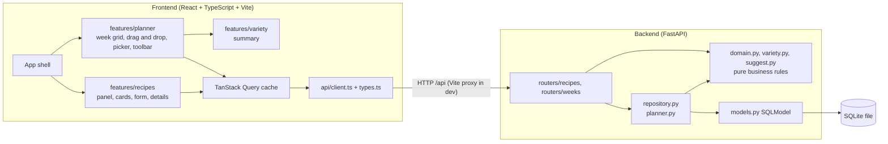

# Cociboard

A web app for planning varied weekly menus from a personal recipe list. A weekly grid
(Monday–Sunday) has a lunch and a dinner slot per day; recipes are dragged (or tapped,
on touch devices) into the slots. See [docs/ROADMAP.md](docs/ROADMAP.md) for scope.

Current version: **0.6.4** (Spanish and English interface).

## Stack

- Backend: Python 3.12, FastAPI, SQLModel + SQLite, pydantic-settings, managed with [uv](https://docs.astral.sh/uv/)
- Frontend: React 18, TypeScript (strict), Vite, TanStack Query, react-i18next, plain CSS with design tokens
- Quality: ruff, mypy (strict), pytest; ESLint, `tsc --noEmit`, Vitest + Testing Library

Rationale: [ADR-0001](docs/adr/0001-tech-stack.md), [ADR-0003](docs/adr/0003-recipe-data-model.md), [ADR-0004](docs/adr/0004-data-fetching-and-icons.md),
[ADR-0005](docs/adr/0005-planner-interaction-design.md), [ADR-0006](docs/adr/0006-week-plan-data-model.md),
[ADR-0007](docs/adr/0007-variety-rules-and-suggestions.md), [ADR-0008](docs/adr/0008-recipe-edits-vs-planned-meals.md),
[ADR-0009](docs/adr/0009-internationalisation.md).

## Architecture



The frontend never talks to the database: all state lives behind the API and is cached by
TanStack Query (optimistic updates for the plan, invalidation after recipe edits). Business
rules (slot compatibility, variety, suggestions) are pure functions in the backend and are
unit-tested without the web layer.

## Setup

Requirements: `uv`, Node.js 20+ and npm, `make`.

```sh
make install
```

uv fetches Python 3.12 automatically (see `backend/.python-version`).

## Commands

| Command | Description |
| --- | --- |
| `make install` | Install backend and frontend dependencies |
| `make dev` | Run backend (`:8000`, uvicorn `--reload`) and frontend (`:5173`, Vite) together; Vite proxies `/api` to the backend (override the target with `COCIBOARD_API_URL`). Ctrl+C stops both |
| `make seed` | Add any missing seed recipes to the database (idempotent) |
| `make test` | pytest and vitest |
| `make lint` | ruff and ESLint |
| `make typecheck` | mypy --strict and `tsc --noEmit` |
| `make check-version` | Verify `VERSION`, `backend/pyproject.toml` and `frontend/package.json` agree |
| `make check` | All gates above |

Open http://localhost:5173 after `make dev`. Configuration of the backend is via
`COCIBOARD_*` environment variables:

| Variable | Default | Description |
| --- | --- | --- |
| `COCIBOARD_DATABASE_URL` | `sqlite:///./cociboard.db` | SQLAlchemy database URL |
| `COCIBOARD_SEED_ON_STARTUP` | `true` | Seed the recipe catalogue when the database is empty |
| `COCIBOARD_CORS_ORIGINS` | `["http://localhost:5173"]` | Allowed CORS origins (JSON list) |

## API

Interactive docs are served at http://localhost:8000/docs.

| Method and path | Description |
| --- | --- |
| `GET /api/health` | Status and version |
| `GET /api/recipes` | List recipes, ordered by name. Filters: `slot=lunch\|dinner` (recipes that fit the slot, including `both`), `q=` (case-insensitive search in name and ingredients), `property=` (repeatable; recipes must have all given properties) |
| `GET /api/recipes/{id}` | One recipe (`404` if missing) |
| `POST /api/recipes` | Create (`201`; `409` duplicate name; `422` invalid) |
| `PATCH /api/recipes/{id}` | Partial update (`404`, `409`, `422`). A `meal_type` change that no longer fits slots the recipe occupies answers `409` with `detail: { code: "meal_type_conflict", message, conflicts: [{ week_start, day, slot }] }`; add `?force=true` to remove those planned meals and apply the change ([ADR-0008](docs/adr/0008-recipe-edits-vs-planned-meals.md)) |
| `GET /api/recipes/{id}/usage` | `{ count }`: planned slots, across all weeks, that use the recipe (`404`) |
| `DELETE /api/recipes/{id}` | Delete (`204`; `404`) |

A recipe has `name` (1-80 chars, unique), optional `description`, `meal_type`
(`lunch`, `dinner`, `both`), `protein` (`meat`, `poultry`, `fish`, `seafood`, `eggs`,
`legumes`, `dairy`, `tofu`, `none`), optional `prep_minutes` (> 0), `ingredients` (at least
one non-empty string) and `properties` (`vegetarian`, `vegan`, `gluten_free`, `dairy_free`,
`quick`, `spicy`, `light`, `kid_friendly`, `batch_cooking`).

### Weekly plans

A week is keyed by the date of its Monday (`week_start`). `day` is 0 (Monday) to 6
(Sunday) and `slot` is `lunch` or `dinner`. Every response is the full week plan:
`{ week_start, days: [{ day, date, lunch, dinner } x7], variety }` where `lunch`/`dinner` are
recipes or `null` and `variety` is the variety report (see below).

| Method and path | Description |
| --- | --- |
| `GET /api/weeks/current` | Plan of the current week |
| `GET /api/weeks/{week_start}` | Plan of a week (`422` if the date is not a Monday) |
| `PUT /api/weeks/{week_start}/days/{day}/{slot}` | Assign `{ "recipe_id": n }`, replacing the current recipe (`404` unknown recipe; `422` not a Monday, day outside 0-6 or recipe does not fit the slot) |
| `DELETE /api/weeks/{week_start}/days/{day}/{slot}` | Clear a slot |
| `PUT /api/weeks/{week_start}` | Replace the whole week with `{ "slots": [{ day, slot, recipe_id }] }`, atomically (used by Undo; `404`/`422` as for a single slot) |
| `DELETE /api/weeks/{week_start}` | Clear the whole week |
| `GET /api/weeks/{week_start}/variety` | Variety report of the week |
| `POST /api/weeks/{week_start}/suggest` | Fill the empty slots with varied, compatible recipes; optional body `{ "seed": n }` makes the result repeatable. Filled slots are never changed |
| `GET /api/weeks/{week_start}/days/{day}/{slot}/candidates` | Recipes that fit the slot, best for variety first, each with `score_delta`, `reason` (English), `reason_code`, `reason_params` and `good_pick` |
| `POST /api/weeks/{week_start}/move` | Move `{ from_day, from_slot, to_day, to_slot }`; swaps if the target is occupied; both recipes must fit (`404` empty source, `422` incompatible) |

Deleting a recipe removes it from all weeks.

### Variety

`variety` is `{ score, filled_slots, issues, protein_counts }`. `score` is 0-100, or `null` for
an empty plan. An issue is `{ kind, severity: "info" | "warning", message, params, slots: [{ day, slot }] }`.
`message` is English and not localised; clients translate from `kind` and `params` (for example
`{ recipe, count }`, or `{ protein, count, from, to }` with slot positions). Candidate reasons work the
same way: `reason` is English, `reason_code` and `reason_params` are what the UI translates.
Rules (thresholds are constants in `variety.py`): a recipe repeated in the week (info if it is
`batch_cooking`), the same main protein in consecutive meals, one protein in more than 4 meals
(warnings); fewer than 2 vegetable-forward meals once 7 slots are filled and fewer than 2 fish
or seafood meals once 10 are filled (info). Score: `90 - 15 * warnings - 5 * infos` plus
`2` per distinct protein beyond the first (at most 10), clamped to 0-100. Details and the
suggestion algorithm: [ADR-0007](docs/adr/0007-variety-rules-and-suggestions.md).

## How to plan a week

1. **Look at the recipes.** The panel lists your catalogue; search by name or ingredient, filter
   by meal type or property, and click a recipe's name for its full details. No recipes yet?
   Use **New recipe** (or **Add your first recipe**).
2. **Fill slots by hand.** Drag a recipe onto a lunch or dinner slot, or tap: tap an empty slot
   and choose from the recipes that fit, or tap **Add** on a recipe and then a highlighted slot.
   Dinner-only recipes never fit lunch slots and vice versa.
3. **Let Cociboard suggest.** **Suggest** fills only the empty slots with varied recipes; use
   **Undo** in the toast if you do not like the result, or run it again after clearing some
   slots. Your own picks are never replaced.
4. **Check the variety.** The badge shows the week's score. Open it to see the issues (a
   repeated recipe, the same protein two meals in a row, too much of one protein) and click
   one to highlight the slots involved. A warning mark on a slot means it takes part in an
   issue; swap that meal or use **Best for variety** in the recipe panel and the picker's
   "Good pick" hints.
5. **Move on.** Use ‹ and › to plan other weeks. To change what a meal is, open its recipe and
   **Edit**; to drop a meal, use its × or **Remove**.

## Managing recipes

- **New recipe** opens a form (a full-screen sheet on phones): name, meal type, main protein,
  prep time, description, ingredients (Enter adds a row; pasting a list splits it into rows)
  and properties. Errors are shown next to the fields.
- Click a recipe name (or choose **View details** on a planned meal) to see everything, then
  **Edit** or **Delete**. Deleting asks for confirmation and shows in how many planned meals the
  recipe is used; those meals are removed with it.
- If you change a recipe's meal type and it is planned in slots that no longer fit, the form
  lists them and offers **Remove them and save**.

## Using the planner

- **Weeks:** use the ‹ and › buttons or **This week** in the planner header; the address bar
  shows `?week=YYYY-MM-DD`, so weeks can be bookmarked and Back/Forward work.
- **Suggest** fills the empty slots with varied recipes (existing meals stay). **Clear week**
  asks for confirmation. Both show a toast with **Undo** for a few seconds.
- **Variety:** the badge shows the week's score (green, amber, red). Open it to read the issues;
  click one to highlight its slots. A ⚠ on a slot means it takes part in a warning. In the
  recipe panel, "×2 this week" marks recipes already planned and **Best for variety** sorts the
  list; the slot picker puts the best fits first, with a reason and a "Good pick" mark.

- **Desktop:** drag a recipe card (or an assigned recipe) onto a slot. Dragging an assigned
  recipe onto another slot moves it or swaps the two; dropping it on the recipe list
  removes it. Compatible slots light up, incompatible ones are dimmed ("Not for lunch").
- **Touch:** press and hold a card for about 0.2 s to drag. Or just tap: tap an empty slot
  to pick a recipe from a list of the ones that fit, tap a filled slot for Replace, Remove
  and View details, or tap **Add** on a recipe and then tap a highlighted slot (Esc or
  Cancel to leave).
- **Keyboard:** Tab to a recipe's drag handle or an assigned recipe, Space to pick it up,
  arrow keys to jump between slots, Space to drop, Esc to cancel. Enter on an assigned
  recipe opens its actions; Enter on an empty slot opens the picker.

## Languages

The interface is available in **English** and **Spanish (Spain)**. Only the interface is
translated: recipe names, ingredients and descriptions stay as written.

- On the first visit the language follows the browser (`navigator.languages`: any `es-*`
  gives Spanish, anything else English).
- The **EN | ES | Auto** switcher in the header overrides it. The choice is saved in
  `localStorage` under `cociboard.language` (per device); **Auto** deletes it, so the
  browser language applies again.
- Detection order: saved choice, browser languages, English.

To add a language: create `frontend/src/i18n/locales/<code>.ts` typed `satisfies Translation`
(the compiler lists every missing key), register it in `src/i18n/index.ts` (`LANGUAGES`,
`resources`), add its locale to `weekMath.ts`, and add a button to the switcher. Design:
[ADR-0009](docs/adr/0009-internationalisation.md).

## Project structure

```
VERSION                 single source of the release version
Makefile
backend/
  pyproject.toml
  src/cociboard/        FastAPI app (main.py), settings, domain rules, models, schemas,
                        repository, planner (week plans), variety (analysis), suggest (auto-fill, candidates),
                        routers/, seed.py
  tests/
frontend/
  src/api/              typed API client and types mirroring backend schemas
  src/features/recipes/ recipe panel, cards, form, details and delete dialogs, mutations, legend, icon metadata
  src/features/planner/ week grid, slots, drag and drop, picker, week navigation, toolbar, optimistic updates, pure logic
  src/features/variety/ variety summary and presentation helpers
  src/i18n/             i18next setup, language detection and switcher, en/es catalogues
  src/styles/           design tokens and global CSS
  src/App.tsx           app shell
docs/
  ROADMAP.md
  adr/                  architecture decision records
CHANGELOG.md
CLAUDE.md               project conventions
```
