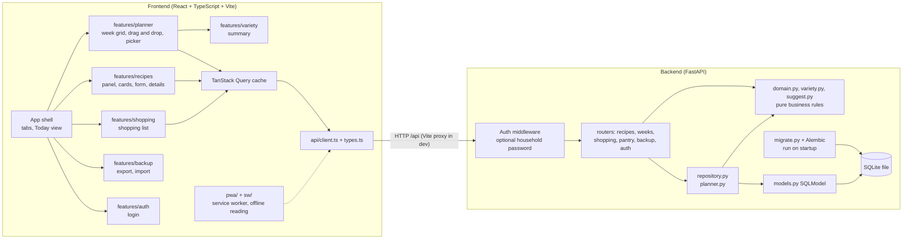

# Cociboard

[](https://github.com/renefs/cociboard/actions/workflows/ci.yml)

A web app for planning varied weekly menus from a personal recipe list. A weekly grid
(Monday–Sunday) has a lunch and a dinner slot per day; recipes are dragged (or tapped,
on touch devices) into the slots. See [docs/ROADMAP.md](docs/ROADMAP.md) for scope.

Current version: **0.22.0** (print and share).

## Stack

- Backend: Python 3.12, FastAPI, SQLModel + SQLite, pydantic-settings, managed with [uv](https://docs.astral.sh/uv/)
- Frontend: React 18, TypeScript (strict), Vite, TanStack Query, react-i18next, plain CSS with design tokens
- Quality: ruff, mypy (strict), pytest; ESLint, `tsc --noEmit`, Vitest + Testing Library

Rationale: [ADR-0001](docs/adr/0001-tech-stack.md),
[ADR-0002](docs/adr/0002-versioning-and-changelog.md),
[ADR-0003](docs/adr/0003-recipe-data-model.md),
[ADR-0004](docs/adr/0004-data-fetching-and-icons.md),
[ADR-0005](docs/adr/0005-planner-interaction-design.md),
[ADR-0006](docs/adr/0006-week-plan-data-model.md),
[ADR-0007](docs/adr/0007-variety-rules-and-suggestions.md),
[ADR-0008](docs/adr/0008-recipe-edits-vs-planned-meals.md),
[ADR-0009](docs/adr/0009-internationalisation.md), [ADR-0010](docs/adr/0010-docker-deployment.md),
[ADR-0011](docs/adr/0011-container-registry-image.md), [ADR-0012](docs/adr/0012-shopping-list.md),
[ADR-0013](docs/adr/0013-schema-migrations.md), [ADR-0014](docs/adr/0014-archive-and-backups.md),
[ADR-0015](docs/adr/0015-planning-across-weeks.md),
[ADR-0016](docs/adr/0016-special-slots-and-notes.md),
[ADR-0017](docs/adr/0017-mobile-navigation.md),
[ADR-0018](docs/adr/0018-optional-household-password.md), [ADR-0019](docs/adr/0019-pwa-offline.md),
[ADR-0020](docs/adr/0020-richer-recipes.md), [ADR-0021](docs/adr/0021-ci-before-publish.md),
[ADR-0022](docs/adr/0022-automatic-backups-and-foreign-keys.md),
[ADR-0023](docs/adr/0023-pantry-staples.md).

## Architecture



The frontend never talks to the database: all state lives behind the API and is cached by
TanStack Query (optimistic updates for the plan, invalidation after recipe edits). Business
rules (slot compatibility, variety, suggestions) are pure functions in the backend and are
unit-tested without the web layer.

## Setup

Requirements: `uv`, Node.js 22+ and npm, `make`.

```sh
make install
```

uv fetches Python 3.12 automatically (see `backend/.python-version`).

## Commands

| Command | Description |
| --- | --- |
| `make install` | Install backend and frontend dependencies |
| `make dev` | Run backend (`:8000`, uvicorn `--reload`) and frontend (`:5173`, Vite) together; Vite proxies `/api` to the backend (override the target with `COCIBOARD_API_URL`). Ctrl+C stops both |
| `make seed` | Add any missing seed recipes to the database (idempotent) |
| `make migrate` | Apply pending schema migrations to `COCIBOARD_DATABASE_URL` (the app also does this on start) |
| `make migration m="message"` | Generate a migration after changing `models.py` (review the file before committing) |
| `make test` | pytest and vitest |
| `make lint` | ruff and ESLint |
| `make typecheck` | mypy --strict and `tsc --noEmit` |
| `make check-version` | Verify every file that holds the version agrees with `VERSION` (pyproject, `__init__.py`, `package.json`, `package-lock.json`, `uv.lock`, this README) |
| `make check` | All gates above |

Open http://localhost:5173 after `make dev`. Configuration of the backend is via
`COCIBOARD_*` environment variables:

| Variable | Default | Description |
| --- | --- | --- |
| `COCIBOARD_DATABASE_URL` | `sqlite:///./cociboard.db` | SQLAlchemy database URL |
| `COCIBOARD_SEED_ON_STARTUP` | `true` | Seed the recipe catalogue when the database is empty |
| `COCIBOARD_CORS_ORIGINS` | `["http://localhost:5173"]` | Allowed CORS origins (JSON list) |
| `COCIBOARD_STATIC_DIR` | unset | Built frontend (`frontend/dist`) to serve at `/`; the Docker image sets it |

## Continuous integration

| Event | What runs |
| --- | --- |
| Pull request, push to a branch other than `main`, manual run | `ci.yml`: job `check` runs `make check` on Python 3.12 and Node 22 with locked dependencies; job `image` builds the amd64 image and runs `scripts/smoke-test.sh` on it |
| Push to `main`, a `vX.Y.Z` tag, manual run of the publish workflow | `docker-publish.yml`: `ci.yml` first (both jobs), then (tags only) a check that the tag equals `v` + `VERSION`, then the multi-arch push to ghcr.io |

The smoke test starts the container with a throwaway volume and requires `/api/health`
to report the version in `VERSION` and `/` to return 200. Run it locally against a built
image with `scripts/smoke-test.sh <image> [port]` (set `CONTAINER_ENGINE=podman` to use
podman). The image is only published when the checks and the smoke test pass. Design:
[ADR-0021](docs/adr/0021-ci-before-publish.md).

### Dependency updates

Dependabot (`.github/dependabot.yml`) opens weekly pull requests for GitHub Actions, npm,
uv and the Docker base images. Minor and patch updates of npm and uv come grouped in one
pull request each; every major update is its own pull request, so one breaking change does
not block the rest. Because CI builds and smoke tests the image on pull requests, a base
image bump that breaks the app fails before merging. Python base images stay below 3.14
(the backend declares `requires-python = ">=3.12,<3.14"`) and Node major versions are
bumped by hand, following the LTS line; patch and minor updates of both are still proposed.

## Deployment (Docker Compose)

The `Dockerfile` builds one image: the backend serves the API at `/api` and the built
frontend at `/`. The SQLite database lives in `./data` next to `docker-compose.yml`. The
base images are multi-arch, so the image builds on x86-64 and ARM64 machines.

```sh
cp .env.example .env    # optional: port, PUID/PGID, time zone
docker compose up -d --build
```

Open `http://<host>:8000`. To update, pull the new sources and run the same command;
the data in `./data` is kept. The app also makes automatic copies of the database
(see [Backups](#backups)).

Database schema changes are applied automatically on start. Before changing an existing
database, the app copies it next to the original as
`cociboard.db.bak-<previous version>-<UTC timestamp>` (the three most recent copies are
kept). To go back to a backup: stop the container, replace `./data/cociboard.db` with the
backup file (copy it, keeping the same name) and start the image version that matches it.

| Setting (`.env`) | Default | Description |
| --- | --- | --- |
| `COCIBOARD_PORT` | `8000` | Port on the host |
| `PUID` / `PGID` | `1000` / `1000` | Owner of `./data`; the server runs as this user |
| `TZ` | `Etc/UTC` | Time zone that decides "today" and the current week (e.g. `Europe/Madrid`) |
| `COCIBOARD_SEED_ON_STARTUP` | `true` | Add the starter recipes when the database is empty |
| `COCIBOARD_PASSWORD` / `COCIBOARD_PASSWORD_HASH` | unset | Optional household password, see [Security](#security-password) |
| `COCIBOARD_SECRET_KEY` | unset | Signs session cookies; by default a key is kept in `./data/cociboard.secret` |
| `COCIBOARD_BACKUP_INTERVAL_HOURS` | `24` | Hours between automatic database copies; `0` turns them off, see [Backups](#backups) |
| `COCIBOARD_BACKUPS_KEPT` | `7` | How many automatic copies are kept (at least 1) |
| `COCIBOARD_BACKUP_DIR` | unset | Folder for the automatic copies (inside the container, e.g. `/data/backups`); by default next to the database |
| `COCIBOARD_RECIPE_IMPORT` | `true` | Allow "Import from a link" on the new-recipe form; `false` turns it off, see [Importing a recipe from a link](#importing-a-recipe-from-a-link) |

The container starts as root only to `chown` `/data`, then drops to `PUID:PGID`. Setting
`user:` in the compose file also works if `./data` is already writable by that user.
Keep `./data` on a local disk: SQLite should not live on a network share (NFS/SMB).

### Synology NAS (DSM 7.2+, Container Manager)

1. Copy the repository to a shared folder, e.g. `/volume1/docker/cociboard` (File Station
   or `git clone` over SSH).
2. Optional: create `.env` from `.env.example`. Set `PUID`/`PGID` to the owner of the
   folder (in SSH, `id <user>` shows e.g. `uid=1026 gid=100`) and `TZ`.
3. Container Manager → **Project** → **Create**: pick the folder as the path; it finds the
   existing `docker-compose.yml`. Finish the wizard (it builds the image, which takes a few
   minutes on a NAS).
4. Open `http://<nas>:8000`, or put it behind DSM's reverse proxy (Control Panel → Login
   Portal → Advanced → Reverse Proxy) to get HTTPS on port 443.

On DSM 7.0/7.1 with the older Docker package, run `sudo docker-compose up -d --build`
in that folder over SSH.

## Deployment (prebuilt image)

GitHub Actions (`.github/workflows/docker-publish.yml`) builds the same image for
`linux/amd64` and `linux/arm64` and pushes it to the GitHub Container Registry as
`ghcr.io/renefs/cociboard`. Nothing is built on the host, so this is the fastest way to
run Cociboard on a NAS. Tags:

| Tag | Updated when |
| --- | --- |
| `latest`, `0.8.0`, `0.8` | A version tag `vX.Y.Z` is pushed (releases only) |
| `main` | Every push to `main` (may be ahead of the last release) |
| `sha-<commit>` | Every build, to pin an exact commit |

The workflow can also be started by hand (Actions → Publish Docker image → Run
workflow). [ADR-0011](docs/adr/0011-container-registry-image.md) explains the setup.

**The image is private** (it inherits the visibility of the private repository), so every
host that pulls it has to log in first:

1. On GitHub, create a personal access token (classic) with only the `read:packages`
   scope: Settings → Developer settings → Personal access tokens → Tokens (classic).
2. On the host, log in once; Docker stores the credentials:

   ```sh
   echo <token> | docker login ghcr.io -u <github-user> --password-stdin
   ```

Then, in an empty folder, copy `docker-compose.ghcr.yml` as `docker-compose.yml`
(optionally with a `.env`, see `.env.example`) and start it:

```sh
docker compose pull
docker compose up -d
```

The settings are the ones in the table above, plus `COCIBOARD_TAG` (default `latest`) to
run another tag. To update, run the same two commands; the data in `./data` is kept and the database is
migrated automatically (a `cociboard.db.bak-*` backup is written next to it first; to
restore one, stop the container and replace `./data/cociboard.db` with the backup).
Switching an existing installation from the source build only needs this compose file in
the same folder, since both use `./data`.

### Synology NAS with the prebuilt image

1. Create a folder, e.g. `/volume1/docker/cociboard`, and put `docker-compose.ghcr.yml`
   in it renamed to `docker-compose.yml` (plus an optional `.env` with `PUID`/`PGID` and
   `TZ`, as in the steps above).
2. Enable SSH (Control Panel → Terminal & SNMP), connect, and log in as root so Container
   Manager can use the credentials:

   ```sh
   echo <token> | sudo docker login ghcr.io -u <github-user> --password-stdin
   ```

   Adding ghcr.io under Container Manager → Registry has been reported to fail with
   GitHub, so the command line is the reliable way to log in.
3. Container Manager → **Project** → **Create**: pick the folder; it finds
   `docker-compose.yml` and pulls the image instead of building it.
4. To update, run `sudo docker compose pull && sudo docker compose up -d` in the folder
   over SSH. Stopping and starting the project in Container Manager does not pull a
   newer image.

To make the image public later: GitHub → the package's page → Package settings → Change
visibility. Then no login is needed.

## Security (password)

By default Cociboard has **no login**: anyone who can reach the port can see and change the
plans. That is fine on a home network; set a household password if the app is reachable from
elsewhere (the app shows a warning banner when it sees a request from a public address while
no password is set).

Set **one** of these in `.env` (both docker-compose files pass them through):

- `COCIBOARD_PASSWORD`: the password in plain text. Simple, but anyone who can read the
  `.env` file can read it.
- `COCIBOARD_PASSWORD_HASH`: a salted scrypt hash, so no plain password is stored. Make it
  with the bundled command, which asks for the password twice (or reads it from stdin):

  ```sh
  docker compose run --rm cociboard python -m cociboard.auth hash   # or: podman compose run ...
  # without Docker: cd backend && uv run python -m cociboard.auth hash
  ```

  The result looks like `scrypt:32768:8:1:<salt>:<hash>` (no `$`, so compose does not mangle
  it); paste it as the value. If both variables are set, the hash wins.

How it works:

- Everyone shares one password. After signing in, a browser keeps a signed, HTTP-only cookie
  for 90 days (`COCIBOARD_SESSION_DAYS`), renewed while the app is used. **Log out** is in the header.
- **Changing the password logs everyone out.**
- Sessions are signed with `COCIBOARD_SECRET_KEY` if set; otherwise a random key is created
  once in `cociboard.secret` next to the database (`./data`, mode 0600) and reused, so sessions
  survive restarts. Keep that file private and out of backups you share.
- Wrong passwords are rate limited: 10 failures per client IP in 15 minutes block that IP, and
  100 failures across all IPs block everyone, for the rest of the window.
- Use **HTTPS** through a reverse proxy (on Synology: DSM's reverse proxy): the password and
  the cookie travel in clear text over plain HTTP. The server honours `X-Forwarded-Proto`, so
  the cookie gets the `Secure` flag behind an HTTPS proxy. Do not publish port 8000 directly.
- The page shell (HTML/JS) stays public; it contains no data. The API requires the session.

Reasoning and alternatives: [ADR-0018](docs/adr/0018-optional-household-password.md).

## Install on a phone / offline

Cociboard is an installable web app (PWA). Open it in the phone's browser and use **Add to
Home Screen** (Safari: Share, then *Add to Home Screen*; Chrome/Android: menu, then *Install
app*). It then opens full screen with its own icon.

- **Offline reading needs HTTPS or `localhost`.** Browsers only allow service workers in a
  secure context. On plain `http://nas:8000` the app works as before but without the
  service worker, so there is no offline mode and no installable prompt on most browsers. Put
  the app behind the HTTPS reverse proxy described under [Security (password)](#security-password).
- **What works offline:** the app opens, and you can see the last plans, recipes and shopping
  lists you loaded while online. A banner says you are offline.
- **Edits made offline** (assigning recipes, ticking shopping items) are applied on screen and
  sent when the connection returns, with the number of waiting changes in the banner. They are
  kept **only while the page stays open**: closing or reloading it first loses them (the
  browser asks before leaving). Backups, login and logout always need the server.
- **Updates:** when a new version is installed, a bar offers **Reload**; nothing changes
  under you until you tap it.
- Logging out also removes the offline copy of your data from the device.
- **Share to Cociboard (Android):** once the app is installed from Chrome, Cociboard appears in
  the share sheet. Share a recipe page from the browser or another app and Cociboard opens the
  new-recipe form and imports it (see [Importing a recipe from a link](#importing-a-recipe-from-a-link)).
  iOS has no web share targets, so there you paste the link into the form.
- Icons are rendered by `uv run --with pillow python frontend/scripts/render_icons.py`.

Reasoning and alternatives: [ADR-0019](docs/adr/0019-pwa-offline.md).

## API

Interactive docs are served at http://localhost:8000/docs. When a password is set (see
[Security](#security-password)), every `/api` route except `health` and `auth/*` answers
`401` `detail: { code: "auth_required" }` without a valid session cookie, and unsafe
requests whose `Origin` header is not the app's own origin get `403` `detail: { code: "bad_origin" }`.

| Method and path | Description |
| --- | --- |
| `GET /api/health` | Status and version |
| `GET /api/auth/status` | `{ enabled, authenticated, exposed }`. Always public. `authenticated` is `true` when no password is set; `exposed` is `true` only when no password is set and the client has a public IP address. Re-issues the session cookie when it is more than a day old |
| `POST /api/auth/login` | Body `{ password }` (max 1024 characters). `204` and the `cociboard_session` cookie on success; `401` `detail: { code: "invalid_password" }`; `429` `detail: { code: "too_many_attempts", retry_after }` plus a `Retry-After` header; `404` `detail: { code: "auth_disabled" }` when no password is set |
| `POST /api/auth/logout` | `204`; deletes the session cookie |
| `GET /api/recipes` | List recipes, ordered by name. Archived recipes are left out unless `archived=true`, which returns only them. Filters: `slot=lunch\|dinner` (recipes that fit the slot, including `both`), `q=` (case- and accent-insensitive search in name and ingredients), `property=` (repeatable; recipes must have all given properties) |
| `POST /api/recipes/import` | Body `{ "url" }`. Reads the schema.org `Recipe` of a public web page and answers `200` with a draft `{ name, description, servings, prep_minutes, ingredients, steps, source_url, warnings }`; **nothing is saved**. `warnings` are codes: `name_truncated`, `steps_truncated`, `ingredients_truncated`, `servings_unknown`, `time_unknown`, `no_ingredients`, `no_steps`, `name_exists`. Errors are `{ detail: { code } }`: `422` `invalid_url`, `blocked_address`, `no_recipe_found`; `502` `fetch_failed` (network error or the site's non-2xx answer, with `status` when there is one); `504` `timeout`; `413` `too_large`; `415` `not_html`; `429` `busy`; `404` `import_disabled` ([ADR-0024](docs/adr/0024-recipe-import.md)) |
| `GET /api/recipes/{id}` | One recipe (`404` if missing) |
| `POST /api/recipes` | Create (`201`; `409` duplicate name, with `detail: { code: "duplicate_name", message, archived }`; `422` invalid, including a `servings` outside 1-50, a `source_url` that is not an `http://` or `https://` link with a host, or steps over the limits) |
| `PATCH /api/recipes/{id}` | Partial update (`404`, `409`, `422`). Sending `null` clears the optional fields `description`, `prep_minutes`, `servings` and `source_url`; `steps: []` clears the steps (`steps` cannot be `null`). `archived: true\|false` archives or restores the recipe without touching planned meals ([ADR-0014](docs/adr/0014-archive-and-backups.md)). A `meal_type` change that no longer fits slots the recipe occupies answers `409` with `detail: { code: "meal_type_conflict", message, conflicts: [{ week_start, day, slot }] }`; add `?force=true` to remove those planned meals and apply the change ([ADR-0008](docs/adr/0008-recipe-edits-vs-planned-meals.md)) |
| `GET /api/recipes/{id}/usage` | `{ count }`: planned slots, across all weeks, that use the recipe (`404`) |
| `DELETE /api/recipes/{id}` | Delete permanently, including its planned meals in every week (`204`; `404`). Prefer archiving |

Recipes also carry `archived` (read-only except through `PATCH`). Archived recipes disappear from
the catalogue, suggestions and slot candidates but stay in the weeks where they are planned.

A recipe has `name` (1-80 chars, unique), optional `description`, `meal_type`
(`lunch`, `dinner`, `both`), `protein` (`meat`, `poultry`, `fish`, `seafood`, `eggs`,
`legumes`, `dairy`, `tofu`, `none`), optional `prep_minutes` (> 0), `ingredients` (at least
one non-empty string) and `properties` (`vegetarian`, `vegan`, `gluten_free`, `dairy_free`,
`quick`, `spicy`, `light`, `kid_friendly`, `batch_cooking`). Since 0.17 it also has optional
`servings` (1-50), `steps` (a list of up to 50 texts of at most 1000 characters; each is
trimmed and empty ones are dropped, default `[]`) and `source_url` (an `http://` or `https://`
link with a host, at most 500 characters; `javascript:`, `data:` and relative links are
rejected). Quantities stay in the free-text ingredients, and search (`q=`) still looks only at
name and ingredients ([ADR-0020](docs/adr/0020-richer-recipes.md)).

### Weekly plans

A week is keyed by the date of its Monday (`week_start`). `day` is 0 (Monday) to 6
(Sunday) and `slot` is `lunch` or `dinner`. Every response is the full week plan:
`{ week_start, days: [{ day, date, lunch, dinner, lunch_special, dinner_special, lunch_note, dinner_note } x7], variety }`
where `lunch`/`dinner` are recipes or `null`, `*_special` is `eating_out`, `leftovers`, `free` or
`null` (a slot holds a recipe **or** a special meal, never both), `*_note` is the slot's note
(at most 120 characters) or `null`, and `variety` is the variety report (see below). Special
meals are filled slots without a recipe: Suggest leaves them alone, and variety and the shopping
list ignore them ([ADR-0016](docs/adr/0016-special-slots-and-notes.md)).

| Method and path | Description |
| --- | --- |
| `GET /api/weeks/current` | Plan of the current week |
| `GET /api/weeks/{week_start}` | Plan of a week (`422` if the date is not a Monday) |
| `PUT /api/weeks/{week_start}/days/{day}/{slot}` | Assign `{ "recipe_id": n, "note"?: s }` **or** `{ "special": "eating_out" \| "leftovers" \| "free", "note"?: s }`, replacing the current entry. The note sent is the note stored (omitted means none; the UI re-sends the existing one). `404` unknown recipe; `422` not a Monday, day outside 0-6, neither or both of `recipe_id`/`special`, note over 120 characters, recipe does not fit the slot, or recipe is archived: `detail: { code: "recipe_archived", message, recipe_id }` |
| `PATCH /api/weeks/{week_start}/days/{day}/{slot}/note` | `{ "note": string \| null }` sets or clears the note of a filled slot (`404` when the slot is empty, `422` when over 120 characters) |
| `DELETE /api/weeks/{week_start}/days/{day}/{slot}` | Clear a slot |
| `PUT /api/weeks/{week_start}` | Replace the whole week with `{ "slots": [{ day, slot, recipe_id \| special, note? }] }`, atomically (used by Undo, so special meals and notes come back too; `404`/`422` as for a single slot, except that archived recipes are accepted so Undo can restore them) |
| `DELETE /api/weeks/{week_start}` | Clear the whole week |
| `GET /api/weeks/{week_start}/variety` | Variety report of the week |
| `POST /api/weeks/{week_start}/suggest` | Fill the empty slots with varied, compatible recipes; optional body `{ "seed": n }` makes the result repeatable. Filled slots are never changed |
| `POST /api/weeks/{week_start}/copy` | Copy the meals (special meals and notes included) of `{ "from_week_start": "YYYY-MM-DD" }` into the **empty** slots of the week (never overwrites; meals with archived recipes are skipped). Answers `{ plan, copied, skipped_archived, source_meals }`. `422` when either date is not a Monday or both are the same week, `409` on a concurrent change |
| `GET /api/weeks/{week_start}/days/{day}/{slot}/candidates` | Recipes that fit the slot, best for variety first, each with `score_delta`, `reason` (English), `reason_code` (including `planned_recently`), `reason_params` (`protein` or `weeks_ago`) and `good_pick` |
| `POST /api/weeks/{week_start}/move` | Move `{ from_day, from_slot, to_day, to_slot }`; swaps if the target is occupied, moving the whole entry (recipe or special meal, with its note); recipes must fit their new slot, special meals fit anywhere (`404` empty source, `422` incompatible) |

Deleting a recipe removes it from all weeks.

### Shopping list

Derived from the week's planned meals; ticks and manual items are stored per week. Every
endpoint answers the full list:
`{ week_start, items: [{ key, name, checked, in_pantry, meals: [{ day, slot, recipe_id, recipe_name }] }], extras: [{ id, name, checked }] }`.
`key` is the ingredient folded for case, accents and spacing, so "Pimentón" and "pimenton"
are one item; `name` is the first spelling met. Ingredients are free text, so there are no
quantities ([ADR-0012](docs/adr/0012-shopping-list.md)). `in_pantry` is true when the key
matches a [pantry](#pantry) item (extras are never pantry items); ticks of pantry items are
still stored per week.

| Method and path | Description |
| --- | --- |
| `GET /api/weeks/{week_start}/shopping-list` | The list of a week (`422` if the date is not a Monday) |
| `PUT /api/weeks/{week_start}/shopping-list/checks` | `{ "key": "...", "checked": true }`: tick or untick a generated item (idempotent; unknown keys are harmless) |
| `DELETE /api/weeks/{week_start}/shopping-list/checks` | Untick every item and extra |
| `POST /api/weeks/{week_start}/shopping-list/extras` | Add `{ "name": "..." }` (1-80 chars after trimming; `201`) |
| `PATCH /api/weeks/{week_start}/shopping-list/extras/{id}` | Change `name` and/or `checked` of an extra (`404` if missing or from another week) |
| `DELETE /api/weeks/{week_start}/shopping-list/extras/{id}` | Remove an extra (`404`) |

### Pantry

Staples the household always has at home, shared by every week ([ADR-0023](docs/adr/0023-pantry-staples.md)).
Behind the login when a password is set.

| Method and path | Description |
| --- | --- |
| `GET /api/pantry` | `{ items: [{ id, key, name }], suggestions: [{ key, name, recipe_count }] }`. Items are sorted by `key`. Suggestions are the ingredients used by the most active (non-archived) recipes, counted once per recipe, excluding keys already in the pantry: at most 8, each used by at least 3 recipes, ties by key |
| `POST /api/pantry` | Add `{ "name": "..." }` (1-80 chars after trimming). `201` with the item; when the folded key already exists, `200` with the existing item (idempotent, never `409`). `422` for an invalid name |
| `DELETE /api/pantry/{id}` | Remove a staple (`204`, `404` if missing) |

### Backup

| Method and path | Description |
| --- | --- |
| `GET /api/backup` | Everything as a JSON download (`cociboard-backup-YYYY-MM-DD.json`, `format_version` 4): recipes (with `archived`, `servings`, `steps` and `source_url`), planned meals (`recipe_ref` or `special`, plus `note`), shopping ticks and extras, and the pantry (`pantry: [{ name }]`). Format: [ADR-0014](docs/adr/0014-archive-and-backups.md), [ADR-0016](docs/adr/0016-special-slots-and-notes.md) |
| `GET /api/backup/status` | State of the automatic database copies: `{ enabled, interval_hours, kept, last_backup_at, copies, last_error, custom_dir }`. `last_backup_at` is `null` until the first copy; `last_error` is `null` or `{ at, code }` with `code` one of `disk_full`, `permission_denied`, `unknown`. Behind the login when a password is set. No host paths are exposed ([ADR-0022](docs/adr/0022-automatic-backups-and-foreign-keys.md)) |
| `POST /api/backup/restore` | Replace **all** data with a backup document, in one transaction. Answers `{ recipes, meals, shopping_checks, shopping_extras, pantry }` (counts). `422` with `detail: { code, message, params }` when the file is invalid (nothing is changed; versions 1 to 4 are accepted; a file without a `pantry` list restores an empty pantry), `413` above 10 MB. A SQLite file is copied to `*.bak-pre-restore-*` first |

### Variety

`variety` is `{ score, filled_slots, issues, protein_counts }`. `score` is 0-100, or `null` for
an empty plan. An issue is `{ kind, severity: "info" | "warning", message, params, slots: [{ day, slot }] }`.
`message` is English and not localised; clients translate from `kind` and `params` (for example
`{ recipe, count }`, or `{ protein, count, from, to }` with slot positions). Candidate reasons work the
same way: `reason` is English, `reason_code` and `reason_params` are what the UI translates.
Rules (thresholds are constants in `variety.py`): a recipe repeated in the week (info if it is
`batch_cooking`), the same main protein in consecutive meals, one protein in more than 4 meals
(warnings); fewer than 2 vegetable-forward meals once 7 slots are filled and fewer than 2 fish
or seafood meals once 10 are filled (info). Score: `90 - 15 * warnings - 5 * infos` plus
`2` per distinct protein beyond the first (at most 10), clamped to 0-100. Details and the
suggestion algorithm: [ADR-0007](docs/adr/0007-variety-rules-and-suggestions.md).

The analysis also looks at the two previous weeks (archived recipes included), see
[ADR-0015](docs/adr/0015-planning-across-weeks.md): `previous_week_protein` (warning, slot
Monday lunch, params `{ protein, recipe }`) when Monday lunch has the same main protein as last
week's Sunday dinner, and `recent_repeat` (info, params `{ recipe, weeks_ago }` with 1 or 2,
batch cooking exempt) when a recipe was also planned in the last two weeks. `recent_repeat`
never changes the score: it is a hint, not a fault.

## How to plan a week

1. **Look at the recipes.** The panel lists your catalogue; search by name or ingredient, filter
   by meal type or property, and click a recipe's name for its full details. No recipes yet?
   Use **New recipe** (or **Add your first recipe**).
2. **Fill slots by hand.** Drag a recipe onto a lunch or dinner slot, or tap: tap an empty slot
   and choose from the recipes that fit, or tap **Add** on a recipe and then a highlighted slot.
   Dinner-only recipes never fit lunch slots and vice versa.
   **Not cooking?** The picker starts with three chips: **Eating out**, **Leftovers** and
   **Free**. Special meals fill the slot so Suggest leaves it alone, they break a run of the
   same protein and add nothing to the shopping list. Use **Add note** in a filled slot's
   actions for a short note (up to 120 characters, "double batch", "Ana's birthday").
3. **Start from last week, or let Cociboard suggest.** **Copy last week** fills the empty slots
   with the previous week's meals (archived recipes are skipped). **Suggest** fills only the
   empty slots with varied recipes, preferring ones you have not cooked recently; use
   **Undo** in the toast if you do not like the result, or run it again after clearing some
   slots. Your own picks are never replaced.
4. **Check the variety.** The badge shows the week's score. Open it to see the issues (a
   repeated recipe, the same protein two meals in a row, too much of one protein) and click
   one to highlight the slots involved. A warning mark on a slot means it takes part in an
   issue; swap that meal or use **Best for variety** in the recipe panel and the picker's
   "Good pick" hints.
5. **Make the shopping list.** Open **Shopping list** to see every ingredient of the week's
   meals, tick items off as you shop, add things by hand and copy or share the rest as text.
6. **Move on.** Use ‹ and › to plan other weeks. To change what a meal is, open its recipe and
   **Edit**; to drop a meal, use its × or **Remove**.

## Managing recipes

- **New recipe** opens a form (a full-screen sheet on phones): name, meal type, main protein,
  prep time, servings, description, ingredients (Enter adds a row; pasting a list splits it into rows),
  numbered steps (Add step, with Move up, Move down and Remove buttons per step; no dragging
  needed), a source link (http or https only) and properties. Errors are shown next to the fields.
- **Import from a link** (top of the new-recipe form): paste the address of a recipe page and
  the form is filled in; see [Importing a recipe from a link](#importing-a-recipe-from-a-link).
- Click a recipe name (or choose **View details** on a planned meal) to see everything, including
  servings, the steps and a link to the original recipe, then
  **Edit**, **Archive** or **Delete**.
- **Archive** hides a recipe from the catalogue and from suggestions but keeps it in the weeks
  where it is planned (marked "Archived"; it still counts for variety). Find archived recipes
  under **Archived (N)** below the catalogue and bring them back with **Restore**. Archived
  recipes cannot be added to a slot until restored.
- **Delete** is permanent. When the recipe is planned, the confirmation shows how many meals
  will disappear from your weeks (past ones included) and recommends **Archive instead**.
- If you change a recipe's meal type and it is planned in slots that no longer fit, the form
  lists them and offers **Remove them and save**.

### Importing a recipe from a link

Paste a link in **Import from a link** (or share a page to the installed app on Android) and
Cociboard fills in the name, description, servings, time, ingredients, steps and the source
link. Nothing is saved until you press **Create recipe**, so check the result, and choose the
meal type and the main protein yourself: pages do not say them. If you had already typed
something you are asked before it is replaced. Notes under the form say what could not be read
or was shortened, and warn when a recipe with that name already exists.

How it works and what it cannot read:
- The **server** downloads the page and reads its schema.org `Recipe` data (JSON-LD), which
  most recipe sites publish for search engines. Pages without it (some blogs, pages that build
  the recipe in the browser, PDFs, paywalled or login-only pages, sites that block automated
  requests) answer "doesn't contain a recipe Cociboard can read".
- Quantities stay in the ingredient text as written; recipe content is never translated.
- Limits: pages up to 2 MiB, 15 seconds in total, at most 5 redirects, two imports at once per
  server (a third waits a moment, then is told to try again).
- Turn it off with `COCIBOARD_RECIPE_IMPORT=false`; the form then hides the option.

Because the server fetches an address someone typed, it is guarded against being used to reach
your home network (SSRF): only `http` and `https` on ports 80 and 443, no `user:pass@`; the name
is resolved by the server and **every** address must be public (loopback, private, link-local,
carrier-grade NAT, multicast, reserved and unique-local ranges are refused, as are IPv6 forms
that embed such an IPv4 address); the connection is then made to that vetted address, with the
site name kept for TLS and the `Host` header, so the address cannot change between the check
and the request (DNS rebinding); redirects are followed by hand and every hop is checked again;
no cookies, credentials or proxy settings are ever sent, and only text pages are read.
Reasoning and alternatives: [ADR-0024](docs/adr/0024-recipe-import.md).

## Using the planner

- **Weeks:** use the ‹ and › buttons or **This week** in the planner header; the address bar
  shows `?week=YYYY-MM-DD`, so weeks can be bookmarked and Back/Forward work.
- **Suggest** fills the empty slots with varied recipes (existing meals stay) and **Copy last
  week** fills them with the previous week's meals. **Clear week** asks for confirmation. All
  three show a toast with **Undo** for a few seconds.
- **Variety:** the badge shows the week's score (green, amber, red). Open it to read the issues;
  click one to highlight its slots. A ⚠ on a slot means it takes part in a warning. In the
  recipe panel, "×2 this week" marks recipes already planned and **Best for variety** sorts the
  list; the slot picker puts the best fits first, with a reason and a "Good pick" mark. Variety
  also looks back: the same protein from last Sunday's dinner on Monday lunch is a warning, and
  recipes from the last two weeks get a tip (and "Planned last week" in the picker).

- **Special meals and notes:** tap an empty slot and choose **Eating out**, **Leftovers** or
  **Free** above the recipe list; tap a filled slot for **Replace**, **Add note** / **Edit
  note** and **Remove**. Special meals are dragged, swapped and removed like recipes; a note
  stays on its slot when you replace the content (edit or remove it from the same actions).
- **Desktop:** drag a recipe card (or an assigned recipe) onto a slot. Dragging an assigned
  recipe onto another slot moves it or swaps the two; dropping it on the recipe list
  removes it. Compatible slots light up, incompatible ones are dimmed ("Not for lunch").
- **Touch:** press and hold a card for about 0.2 s to drag. Or just tap: tap an empty slot
  to pick a recipe from a list of the ones that fit, tap a filled slot for Replace, Remove
  and View details (plus **Save leftovers for the next meal** on a batch-cooking recipe whose
  next slot is empty: it plans "Leftovers" there with the recipe name as the note; nothing is
  offered after Sunday dinner), or tap **Add** on a recipe and then tap a highlighted slot (Esc or
  Cancel to leave).
- **Phone (below 900 px):** one view at a time, chosen in the bar at the bottom: **Today**
  (today's and tomorrow's lunch and dinner with ingredients and notes; tap a recipe for its
  details), **Week** (the planner; it opens on today's card), **Recipes** and **Shopping**
  (the shopping list of the week you are browsing, inline). **Add** on a recipe takes you to
  the Week tab to pick a slot. The tab is kept in the address as `?view=today|week|recipes|shopping`.
  On desktop everything stays on one screen.
- **Share** (planner toolbar) opens a small menu: **Print the menu** (a clean A4 table of the
  week, black on white, through the browser's print dialog, so "Save as PDF" works too),
  **Share the menu** (the system share sheet; **Copy the menu** where there is none, and a box
  with the text to select when the clipboard is not available, as on plain-http LAN access) and
  **Add to calendar (.ics)** (one event per planned meal, lunch 14:00 and dinner 21:00 in your
  own time zone; importing a later file updates the events instead of duplicating them). The
  items are disabled while the week has no meals ([ADR-0025](docs/adr/0025-print-and-share.md)).
- **Keyboard:** Tab to a recipe's drag handle or an assigned recipe, Space to pick it up,
  arrow keys to jump between slots, Space to drop, Esc to cancel. Enter on an assigned
  recipe opens its actions; Enter on an empty slot opens the picker.

## Shopping list

**Shopping list** in the planner toolbar opens the ingredients of the week's planned meals
(a full-screen sheet on phones).

- Equal ingredients are merged ("Aceite de oliva" and "aceite de oliva" are one line). Each
  line shows the recipes that use it and "×2" when it is needed in more than one meal.
- Tick a line to move it from **To buy** to **In the basket**; untick it to bring it back.
  Ticks are saved on the server, so everyone using the same Cociboard sees them.
- **Add an item** adds your own line ("milk", "bread") to the week; remove it with ×.
- **Copy** puts what is still to buy on the clipboard as a plain "- item" list (the button
  reads **Share** and opens the share sheet where the browser supports it; without a clipboard
  it shows the text to select); **Print** gives a checklist with an empty box per item, then the
  bought and pantry items in small print; **Uncheck all** starts over.
- The list follows the plan and recipe edits; ticks of ingredients that are no longer needed
  are kept and come back if the ingredient does.
- Staples such as oil or salt can be kept off the list, see [Pantry](#pantry).

### Pantry

Ingredients you always have at home. The pantry is shared by all weeks.

- **Always at home** (the house button on a line) moves an ingredient to **In the pantry**, a
  collapsed section at the end of the list. Pantry items are not counted in the progress, are
  left out of **Copy** and **Share** (a last line, "Also check at home: ...", names them) and
  come back with **Need to buy**.
- **Manage pantry** lists every staple (remove with ×), adds any ingredient by name, even one
  that is not in this week's plan, and offers **suggestions**: the ingredients used by the
  most of your recipes (archived ones are ignored; at least 3 recipes, up to 8 shown).
- Matching is exact on the ingredient name with case, accents and extra spaces ignored:
  "aceite de oliva" matches "Aceite de Oliva" but not "Aceite de oliva virgen extra". Add each
  spelling you use. Details: [ADR-0023](docs/adr/0023-pantry-staples.md).
- Changes made offline wait for the connection like other edits and count in the offline banner.

## Backups

The **Backup** button in the header opens the backup dialog (a full-screen sheet on phones).

- **Download backup** saves one JSON file (format version 4) with all recipes (archived ones
  too), weekly plans (special meals and notes included), shopping lists and the pantry. Files
  written by earlier versions (format versions 1 to 3; they have no pantry) can still be restored. Keep it somewhere safe; it is also a way to move your data to another
  installation.
- **Restore from file** reads a backup file, shows what it contains (recipes, planned meals,
  shopping items, export date) and asks for confirmation. Restoring **replaces everything**
  (there is no merge). Nothing changes if the file is invalid.
- The dialog also shows the **automatic copies**: when the last one was made, how many are
  kept, and a warning when the last attempt failed.

### Copies the server makes

The server copies the database file (SQLite online backup, safe while the app runs) in
three situations. Each kind rotates on its own, so one kind never pushes out another.

| Kind | File name | When | Kept |
| --- | --- | --- | --- |
| Automatic | `cociboard.db.bak-auto-<UTC timestamp>` | At startup and then about every `COCIBOARD_BACKUP_INTERVAL_HOURS` (default 24), but only if the data changed since the last automatic copy | `COCIBOARD_BACKUPS_KEPT` (default 7) |
| Schema upgrade | `cociboard.db.bak-<previous revision>-<timestamp>` (or `bak-legacy-`) and `cociboard.db.bak-integrity-<timestamp>` | Before a migration, and before the startup check removes planned meals that point at a deleted recipe (see below) | 3 |
| Before a restore | `cociboard.db.bak-pre-restore-<timestamp>` | Before **Restore from file** | 3 |

Automatic copies go next to the database (`./data`) unless `COCIBOARD_BACKUP_DIR` is set,
e.g. `/data/backups` to keep them in `./data/backups`; the other kinds always stay next to
the database. Copies already made stay where they were if you change the folder. A copy
only protects against mistakes and file damage, not against losing the disk: also copy
`./data` (or a downloaded backup file) somewhere else now and then. If a copy cannot be
written (disk full, permissions) the app keeps running, logs an error and shows a warning in
the backup dialog.

To go back to a copy (any kind), with Docker:

1. Stop the container: `docker compose stop`.
2. Copy the chosen file over the database, keeping the database's name:
   `cp data/cociboard.db.bak-auto-20261120T031500Z data/cociboard.db` (use the copy from
   `COCIBOARD_BACKUP_DIR` if you set one). Keep a copy of the current file first if unsure.
3. Remove `data/cociboard.db-wal` and `data/cociboard.db-shm` if they exist.
4. Start it again: `docker compose start`. Use the image version that matches the copy (for
   a schema-upgrade copy, the version before the upgrade; automatic copies are of the version
   that made them).

### Foreign keys

SQLite does not enforce foreign keys unless asked; since v0.19.0 the app does, so a planned
meal can no longer point at a missing recipe. Migrations run with enforcement off (table
rebuilds need it) and on start the app runs `PRAGMA quick_check` and `PRAGMA
foreign_key_check`. Planned meals left over from earlier versions whose recipe no longer
exists are removed after a `bak-integrity-` copy, and logged (count and weeks). Anything
else unexpected is only logged as an error.

### Without the UI

Stop the container and copy `./data/cociboard.db` (the whole file) somewhere safe; to go
back, copy it over the database and start the image version that matches it.

Design: [ADR-0014](docs/adr/0014-archive-and-backups.md),
[ADR-0022](docs/adr/0022-automatic-backups-and-foreign-keys.md).

## Languages

The interface is available in **English** and **Spanish (Spain)**. Only the interface is
translated: recipe names, ingredients and descriptions stay as written.

- On the first visit the language follows the browser (`navigator.languages`: any `es-*`
  gives Spanish, anything else English).
- The **EN | ES | Auto** switcher in the header overrides it. The choice is saved in
  `localStorage` under `cociboard.language` (per device); **Auto** deletes it, so the
  browser language applies again.
- Detection order: saved choice, browser languages, English.

To add a language: create `frontend/src/i18n/locales/<code>.ts` typed `satisfies Translation`
(the compiler lists every missing key), register it in `src/i18n/index.ts` (`LANGUAGES`,
`resources`), add its locale to `weekMath.ts`, and add a button to the switcher. Design:
[ADR-0009](docs/adr/0009-internationalisation.md).

## Project structure

```
VERSION                 single source of the release version
Makefile
Dockerfile              production image (frontend build + backend)
docker-compose.yml      deployment; settings in .env (see .env.example)
docker-compose.ghcr.yml deployment from the prebuilt image on ghcr.io
.github/workflows/      ci.yml (make check), docker-publish.yml (check, smoke test, push to ghcr.io)
.github/dependabot.yml  weekly grouped dependency updates
scripts/check-version.sh  backs make check-version
docker/entrypoint.sh    fixes /data ownership, drops to PUID:PGID
backend/
  pyproject.toml
  src/cociboard/        FastAPI app (main.py), settings, domain rules, models, schemas,
                        repository, planner (week plans), variety (analysis), suggest (auto-fill, candidates),
                        shopping (ingredient grouping), shopping_repo (ticks and extras),
                        pantry (staple suggestions), pantry_repo (pantry),
                        backup (backup format and validation), backup_repo (export, restore),
                        dbfiles (SQLite file copies and rotation), autobackup (automatic copies),
                        integrity (startup check),
                        recipe_import/ (import from a link: validate, fetch, parse),
                        routers/, seed.py, migrate.py, migrations/
  alembic.ini           CLI configuration for `make migrate` / `make migration`
  tests/
frontend/
  src/api/              typed API client and types mirroring backend schemas
  src/features/recipes/ recipe panel, cards, form, details and delete dialogs, mutations, legend, icon metadata
  src/features/planner/ week grid, slots, drag and drop, picker, week navigation, toolbar, optimistic updates, phone tab bar and Today view, pure logic
  src/features/share/ share menu, print views, share-or-copy, .ics export, pure text builders
  src/features/variety/ variety summary and presentation helpers
  src/features/shopping/ shopping list (dialog and inline view), pantry panel, hooks with optimistic updates, pure logic
  src/features/backup/  backup dialog (download, restore with confirmation, automatic copies status), header button, pure checks
  src/i18n/             i18next setup, language detection and switcher, en/es catalogues
  src/styles/           design tokens and global CSS
  src/App.tsx           app shell
docs/
  ROADMAP.md
  adr/                  architecture decision records
CHANGELOG.md
CLAUDE.md               project conventions
```
