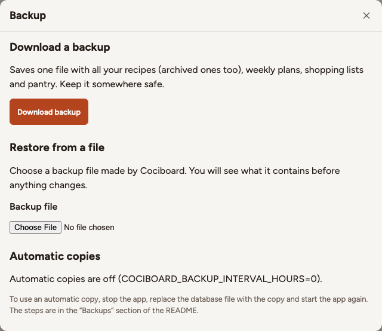

# Backups

**Backup** in the :material-cog: **Settings** menu in the header opens the backup dialog.

{ .screenshot .dialog }

## Download a backup

**Download backup** saves one file with all your data: recipes (archived ones too), weekly
plans, shopping lists, the pantry and the household preferences. Keep it somewhere safe. It is
also the way to move your data to another Cociboard.

## Restore from a file

Choose a backup file. Cociboard first shows what it contains (recipes, planned meals, shopping
items and the date it was made) and asks you to confirm.

!!! danger "Restoring replaces everything"
    Restoring doesn't merge: all the current recipes, plans, shopping lists and pantry are
    replaced by the file's contents. If the file is not valid, nothing changes. The server
    keeps a copy of the data as it was just before the restore.

Backups made by older versions of Cociboard can be restored too.

## Automatic copies

The server also copies the whole database on its own, every day by default and only when
something changed, and keeps the last seven. The dialog shows when the last one was made and
warns you if one failed. Going back to one of these copies is done on the server, so ask
whoever installed Cociboard.
