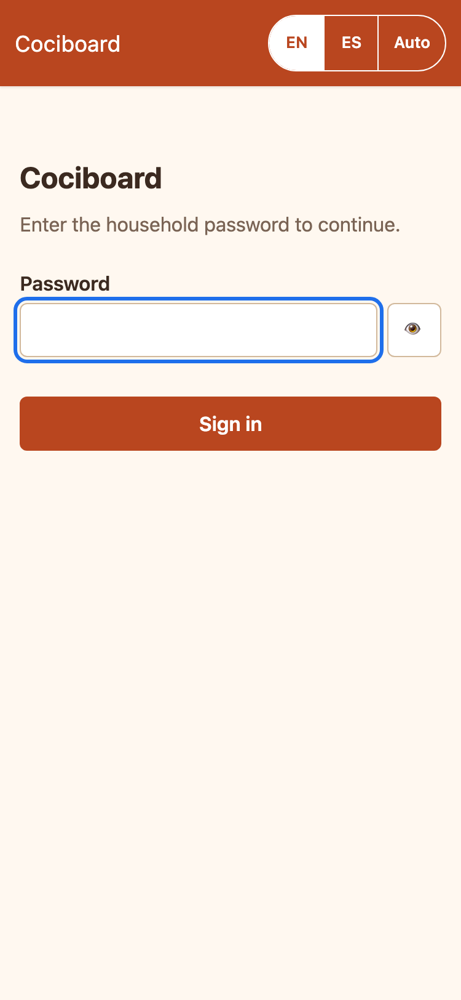
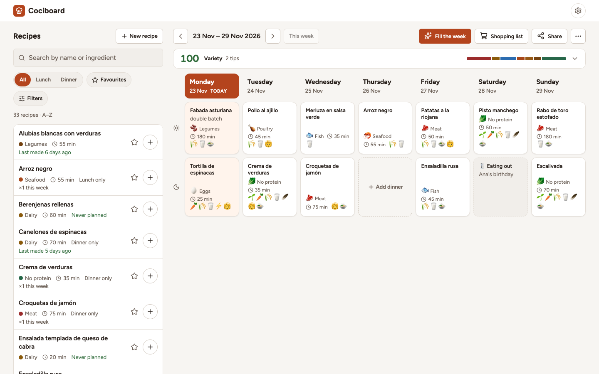

# Getting started

Cociboard runs in the web browser. Open the address your household uses for it (for example
`http://192.168.1.10:8000`, or the one whoever installed it gave you). There is nothing to
install on a computer; on a phone you can [add it to the home screen](phone.md#install-it-like-an-app).

## Signing in

If your household has set a password, Cociboard asks for it first. Everyone at home shares the
same password. After signing in, the browser remembers you for 90 days, renewed every time you
use it.

{ .screenshot .phone }

Use **Log out** in the header to sign out on a shared computer. Without a password set, there
is no sign-in screen at all.

## A tour of the screen

On a computer, everything is on one screen:

{ .screenshot }

**Header** (top)
:   The :material-cog: button opens the [household preferences](preferences.md), **Backup**
    opens the [backup](backups.md) dialog, and **EN | ES | Auto** chooses the language.

**Recipes** (left)
:   Your recipe catalogue, with search, filters and sorting. Drag a card into the week, or use
    **Add**. See [Recipes](recipes.md).

**Weekly planner** (right)
:   Seven days, each with a lunch and a dinner slot. Above it are the week navigation, the
    actions for the whole week and the variety indicator.

{ .screenshot }

On a phone the same sections are shown one at a time, chosen in a bar at the bottom of the
screen. See [On your phone](phone.md).

## Language

{ .screenshot }

The first time you open Cociboard it uses your browser's language (Spanish for any Spanish
browser, English otherwise). Choose **EN** or **ES** in the header to change it on this device,
or **Auto** to follow the browser again.

Only the interface is translated. Your recipes stay exactly as you wrote them.

## The starter recipes

A new Cociboard comes with 33 classic Spanish recipes (in Spanish), each with its
ingredients, servings and cooking steps, so you can start planning straight away. Edit them,
archive the ones you don't cook, and add your own.
