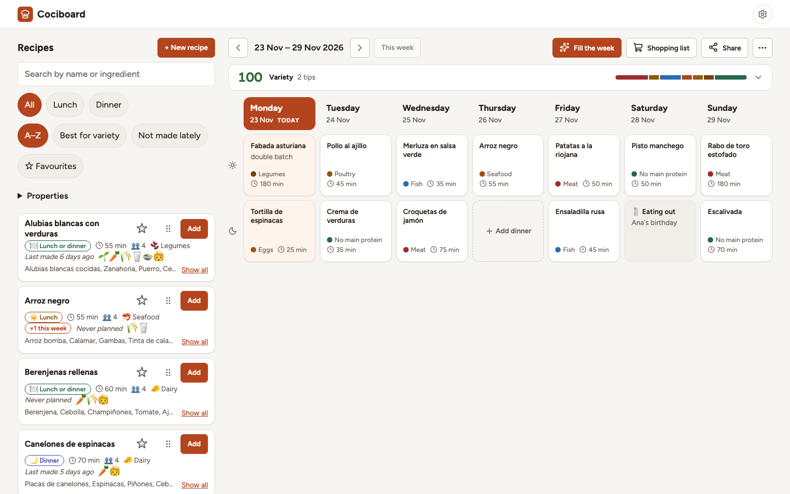

# Plan varied weekly menus, without the effort

Cociboard is a weekly menu planner for your household. You keep your own recipes, put them
into a Monday-to-Sunday grid with a **lunch** and a **dinner** for every day, and Cociboard
helps you keep the week varied, builds the shopping list and lets you share the menu.

{ .screenshot }

## What you can do

-   :material-calendar-week: **[Plan the week](planning.md)**

    Drag recipes into the days, or tap a slot and choose. Mark meals as *Eating out* or
    *Leftovers* and add short notes.

-   :material-auto-fix: **[Let Cociboard suggest](planning.md#let-cociboard-fill-the-week)**

    Fill the empty slots in one click with varied recipes you have not cooked lately.

-   :material-chart-donut: **[Keep it varied](variety.md)**

    A score and gentle tips point out repeated recipes and the same protein several meals in a row.

-   :material-book-open-variant: **[Keep your recipes](recipes.md)**

    Ingredients, steps, servings and the original link. Import a recipe from a web page.

-   :material-cart: **[Shop with a list](shopping.md)**

    The ingredients of the week in one list, shared by everyone at home, without the staples
    you always have.

-   :material-cellphone: **[Use it on your phone](phone.md)**

    Install it like an app, see today's meals at a glance, and keep working without a connection.

## Start here

1. Read [Getting started](getting-started.md) for a tour of the screen.
2. Follow [Planning the week](planning.md) to fill your first week.
3. Open the [shopping list](shopping.md) and you are ready to cook.

!!! tip "In a hurry?"
    Press **Fill the week** on an empty week, look at the result, change what you don't fancy, and
    open **Shopping list**. That's a week planned in two minutes.

The interface is available in English and Spanish, and so is this guide: use the
:material-translate: language menu at the top of the page.
