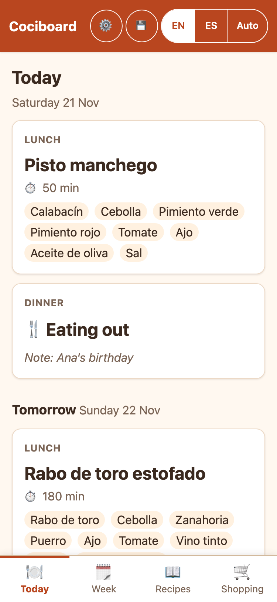
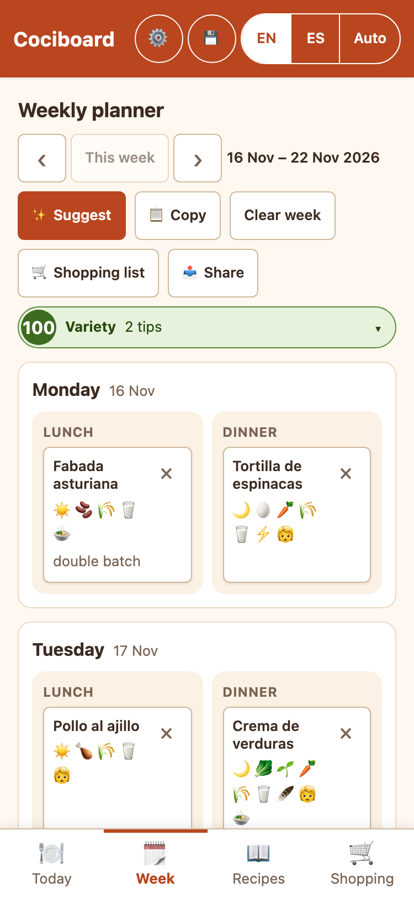
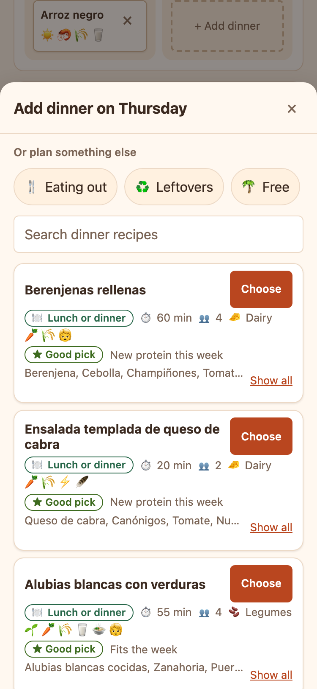
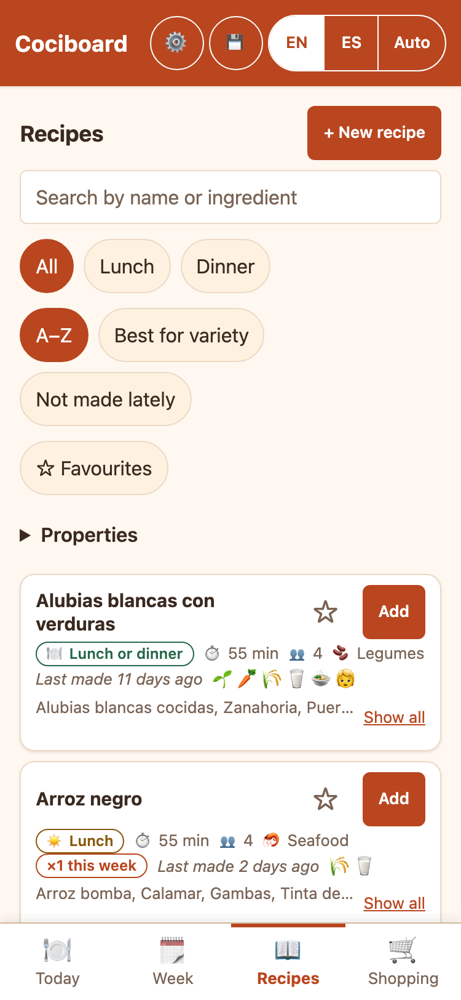
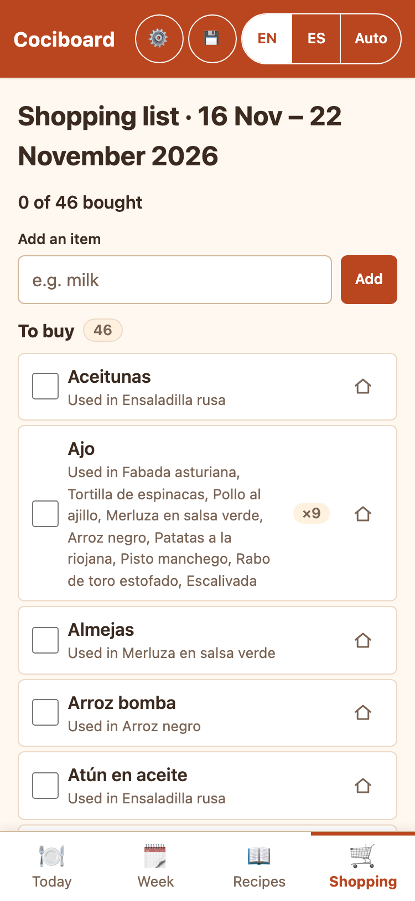

# On your phone

Cociboard is designed for phones as much as for computers. On a narrow screen it shows one
section at a time, chosen in the bar at the bottom:

{ .screenshot .phone }

{ .screenshot .phone }

{ .screenshot .phone }

**Today**
:   Today's and tomorrow's lunch and dinner, with the ingredients and notes. Tap a recipe to
    see its steps while you cook.

**Week**
:   The planner. It opens on today's card. Tap a slot to choose a recipe, tap a meal for its
    actions. You can also drag: press and hold a meal for a moment, then move it.

**Recipes**
:   The catalogue. **Add** on a recipe takes you to the week to pick a slot.

**Shopping**
:   The shopping list of the week you are looking at, ready to tick off in the shop.

{ .screenshot .phone }

{ .screenshot .phone }

## Install it like an app

Add Cociboard to the home screen and it opens full screen with its own icon:

=== "iPhone and iPad (Safari)"

    Tap **Share** :material-export-variant:, then **Add to Home Screen**.

=== "Android (Chrome)"

    Open the menu :material-dots-vertical:, then **Install app** (or **Add to Home screen**).

When a new version of Cociboard is installed, a bar offers **Reload**; nothing changes until you
tap it.

## Without a connection

If your phone loses the connection, Cociboard keeps working with what it last loaded: the
plans, recipes and shopping lists you already opened. A banner says you are offline.

You can keep **planning, ticking shopping items, changing the pantry, the preferences and your
favourites**. The changes show at once and the banner counts the ones waiting. They are kept
on the phone even if you close the app, and are sent in order as soon as the connection is
back.

!!! warning "Good to know"
    - Changes waiting for more than 7 days are discarded (Cociboard tells you how many).
    - Creating and editing recipes, backups, signing in and out need the connection.
    - Working offline needs the secure (`https://`) address of Cociboard. On a plain `http://`
      address the app works normally but can't be used offline. Ask whoever installed it.
