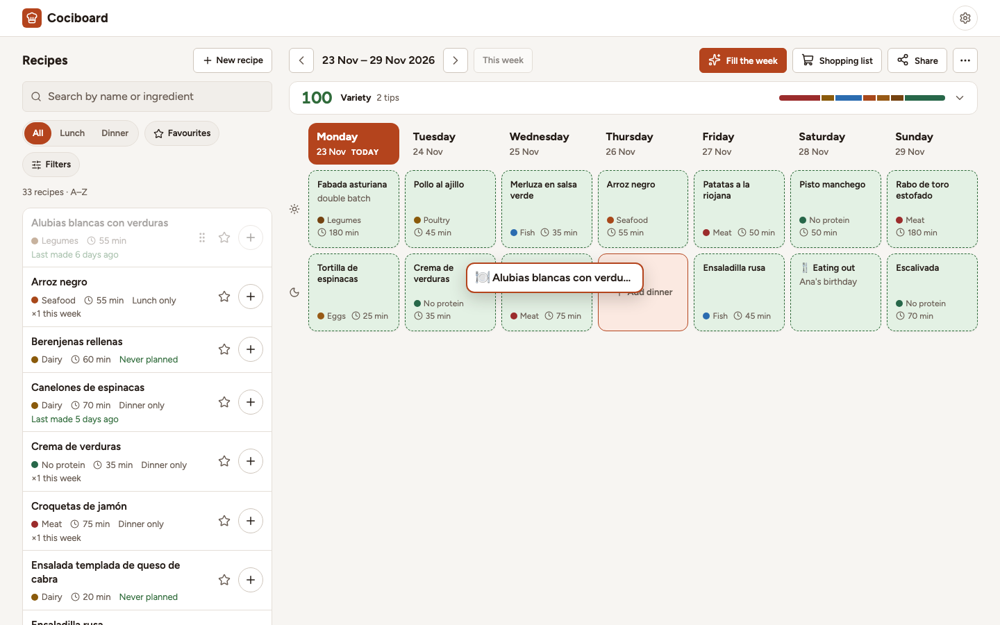
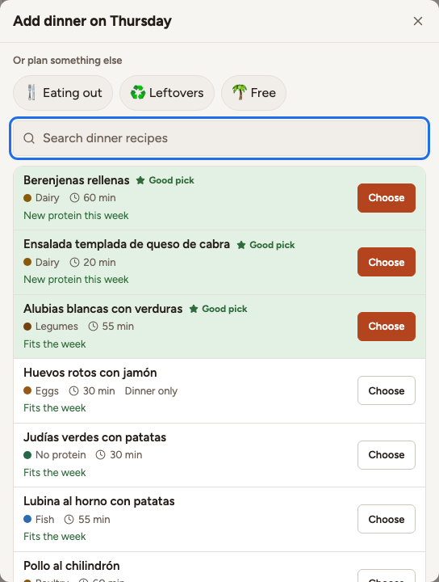
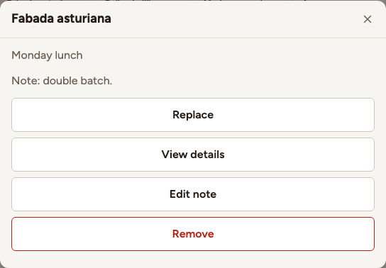
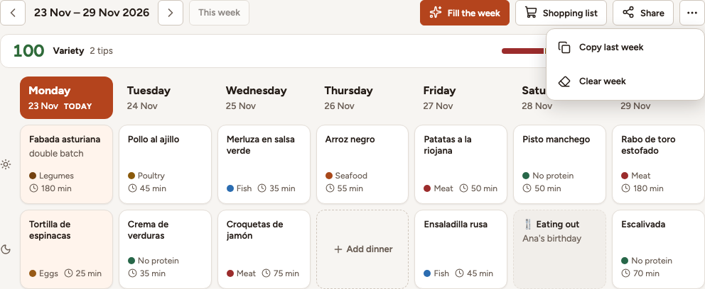

# Planning the week

Each day has two slots, **lunch** and **dinner**. A slot holds one recipe, a special meal
(*Eating out*, *Leftovers*, *Free*) or nothing.

On a computer the week is a grid: one column per day, a row for lunch (:material-weather-sunny:)
and a row for dinner (:material-weather-night:). A planned recipe is a card with its name, a
coloured dot with its main protein and its prep time. An empty slot is a dashed box with
**Add lunch** or **Add dinner**. A :material-alert: mark on a card means it is part of a
[variety warning](variety.md). Today's column is highlighted.

## Moving between weeks

Use **‹** and **›** to go to the previous or next week, and **This week** to come back. The
week is part of the page address, so you can bookmark a week and the browser's Back button
works.

## Adding a meal

There are three ways; use whichever suits you.

### Drag and drop (computer)

Drag a recipe from the list onto a slot. While you drag, the slots that accept the recipe
are highlighted and the others are dimmed: a dinner-only recipe never fits a lunch slot, and
vice versa.

{ .screenshot }

You can drag meals that are already planned too: drop one on another slot to **move** it, on an
occupied slot to **swap** the two, or back on the recipe list to **remove** it from the week.

### Tap a slot and choose

Tap (or click) an empty slot. A list opens with only the recipes that fit that slot, the best
choices for variety first; the best ones get a green background and a **Good pick** tag, and each row has a short reason
("Adds fish or seafood", "New protein this week"; a warning with its icon when it would hurt
the variety) to help you choose. Type to search, then press **Choose**.

{ .screenshot .dialog }

### Add, then pick a slot

Press the round **+** button on a recipe, then tap one of the highlighted slots. Press **Esc** or
**Cancel** to stop.

!!! info "Using the keyboard"
    Tab to a recipe's drag handle :material-drag: or to a planned meal and press **Space** to
    pick it up. Use the arrow keys to jump between slots, **Space** to drop it and **Esc** to
    cancel. **Enter** on a planned meal opens its actions; **Enter** on an empty slot opens the
    picker. Every step is announced to screen readers.

## Not cooking? Special meals

At the top of the picker, under **Or plan something else**, you'll find:

| Choice | Use it for |
| --- | --- |
| :fork_and_knife: **Eating out** | A meal at a restaurant or at someone's house |
| :recycle: **Leftovers** | Eating what's left from an earlier meal |
| :palm_tree: **Free** | A slot you deliberately leave open |

A special meal fills the slot, so **Fill the week** leaves it alone. It also breaks a run of the
same protein and adds nothing to the shopping list.

## Changing a planned meal

Tap a planned meal to see what you can do with it:

{ .screenshot .dialog }

- **Replace** opens the picker to choose something else.
- **View details** shows the full recipe.
- **Add note** / **Edit note**: a short note of up to 120 characters ("double batch",
  "Ana's birthday"). The note stays on the slot when you replace the meal.
- **Remove** empties the slot. The small **×** on the meal does the same (with a mouse it
  appears when you point at the meal; on a touch screen it is always there).
- **Save leftovers for the next meal** appears for *batch cooking* recipes when the next slot
  is empty: it plans *Leftovers* there, with the recipe name as the note.

To change the recipe itself (its ingredients, for example), open it and press **Edit**; every
week that uses it shows the change.

## Let Cociboard fill the week

The buttons above the grid work on the whole week. **Fill the week** is the main one; the
other two are in the :material-dots-horizontal: **More** menu (*More week actions*).

{ .screenshot }

**Fill the week**
:   Fills only the **empty** slots with varied recipes that fit them, preferring ones you
    haven't cooked recently and respecting your [household preferences](preferences.md). Your
    own choices are never replaced. Run it again after emptying a few slots to get other ideas.
    It is greyed out when every slot is already filled.

**Copy last week** (in **More**)
:   Fills the empty slots with last week's meals (special meals and notes included). Archived
    recipes are skipped.

**Clear week** (in **More**)
:   Empties the whole week, after asking you to confirm.

After any of the three, a message with **Undo** appears for a few seconds. Press it to put the
week back exactly as it was.

!!! tip
    A good routine: plan the meals you really want first, then press **Fill the week** to fill
    the gaps.
