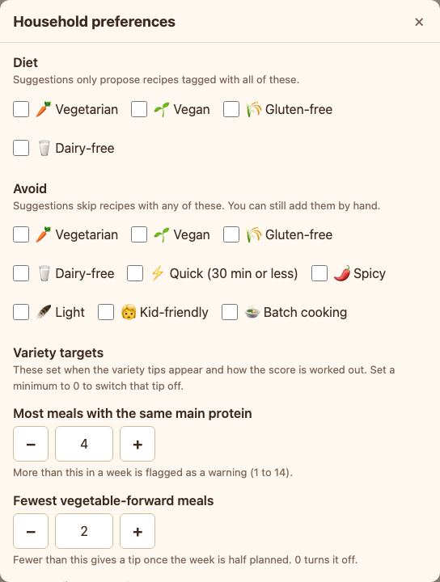

# Household preferences

The :material-cog: button in the header opens the preferences of your household. They are
shared by everyone using the same Cociboard.

{ .screenshot .dialog }

## Diet

Tick **vegetarian**, **vegan**, **gluten-free** or **dairy-free** and the suggestions (the
**Suggest** button and the best-first order in the slot picker) only propose recipes tagged
with all of them.

## Avoid

Tick any property (for example **spicy**) and suggestions skip recipes that have it.

Recipes are matched on their tags as they are: a recipe tagged only *vegan* doesn't count as
*vegetarian*, so tag your recipes carefully.

!!! info "Preferences never block you"
    You can still put any recipe in any slot yourself. In the slot picker, recipes outside your
    preferences come last, marked "Outside your household preferences". If your preferences
    leave slots empty, **Suggest** tells you.

## Variety targets

These numbers decide when the [variety](variety.md) tips appear and how the score is worked out:

- **Most meals with the same main protein** (1 to 14, default 4).
- **Fewest vegetable-forward meals** (default 2).
- **Fewest fish or seafood meals** (default 2).

Set a minimum to **0** to switch that tip off.

## Meal times

When lunch and dinner start in the [calendar file](sharing.md) you export (default 14:00 and
21:00).

Press **Save**. The change applies straight away, even without a connection (it is sent as
soon as you are back online).
