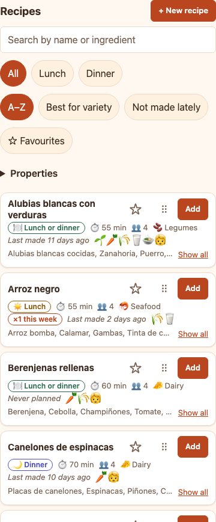
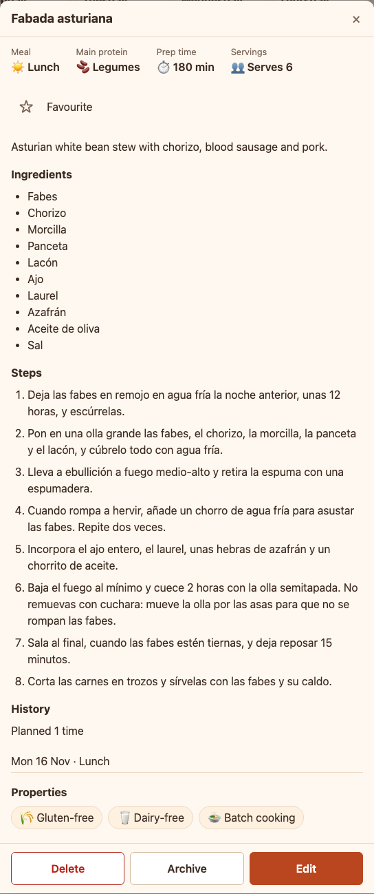
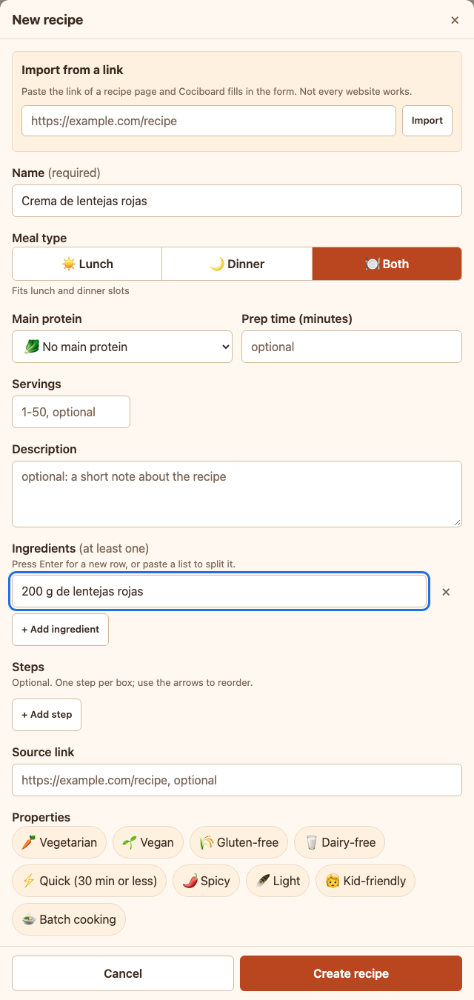

# Recipes

The recipe list is your catalogue: everything you can put into the week.

{ .screenshot .dialog }

## Finding a recipe

- **Search** by name or ingredient. Upper and lower case and accents don't matter:
  "pimenton" finds "Pimentón".
- **All / Lunch / Dinner** shows the recipes that fit that meal.
- **Properties** filters by vegetarian, vegan, gluten-free, quick and so on (a recipe must have
  all the ones you tick).
- :star: **Favourites** shows only your favourites, together with the other filters.
- Sort **A–Z**, by **Best for variety**, or by **Not made lately** (recipes never planned
  first, then the ones planned longest ago).

Each card shows the meal type, prep time, servings, main protein and properties as icons (open
**Legend** below the list to see what each icon means), when you last made it ("Last made 3
days ago", "Never planned") and how many times it is in the current week.

## Recipe details

Click a recipe's name (or **View details** on a planned meal) to see everything about it:

{ .screenshot .dialog }

- The ingredients and the numbered **steps**, and a link to the original recipe if it has one.
- **History**: how many times you have planned it, the next time it is planned and the latest
  meals.
- :star: **Favourite** marks it as a favourite. Favourites are a shortcut for you; they don't
  change what **Suggest** proposes.
- **Edit**, **Archive** and **Delete** at the bottom.

## Adding a recipe

Press **New recipe**. On a phone the form opens full screen.

{ .screenshot .dialog }

| Field | |
| --- | --- |
| **Name** | Required, unique, up to 80 characters |
| **Meal type** | **Lunch**, **Dinner** or **Both**. It decides which slots the recipe fits |
| **Main protein** | Used by the [variety](variety.md) checks |
| **Prep time**, **Servings**, **Description** | Optional |
| **Ingredients** | At least one. **Enter** adds a row; pasting a list splits it into rows. Write quantities as you like ("200 g lentils") |
| **Steps** | Optional, numbered. Reorder them with the arrow buttons |
| **Source link** | Optional, the page where the recipe comes from |
| **Properties** | Vegetarian, vegan, gluten-free, dairy-free, quick, spicy, light, kid-friendly, batch cooking |

Press **Create recipe** to save it.

### Importing a recipe from a web page

At the top of the form, paste the address of a recipe page in **Import from a link** and press
**Import**. Cociboard fills in the name, description, servings, time, ingredients, steps and
source link. **Nothing is saved until you press Create recipe**, so check the result and choose
the **meal type** and the **main protein** yourself: web pages don't say them.

Most recipe websites work, because they publish their recipes in a standard format for search
engines. Some don't (pages behind a login, PDFs, sites that block automatic access); Cociboard
tells you when it can't read a page.

!!! tip "On Android"
    Once Cociboard is [installed on your phone](phone.md#install-it-like-an-app), it appears in
    the **Share** menu. Share a recipe page from the browser and Cociboard opens the form and
    imports it.

## Editing a recipe

Open the recipe and press **Edit**. Changes show in every week where the recipe is planned. If
you change the meal type and the recipe is planned in slots that no longer fit (a lunch recipe
turned into dinner-only, say), the form lists them and offers **Remove them and save**.

## Archive or delete?

**Archive** (recommended)
:   Hides the recipe from the list and from suggestions, but keeps it in the weeks where it was
    planned, marked "Archived". Find it again under **Archived (N)** at the bottom of the list
    and bring it back with **Restore**.

**Delete**
:   Removes the recipe for good, together with every meal that uses it, in past weeks too. The
    confirmation tells you how many meals will disappear and suggests **Archive instead**.
