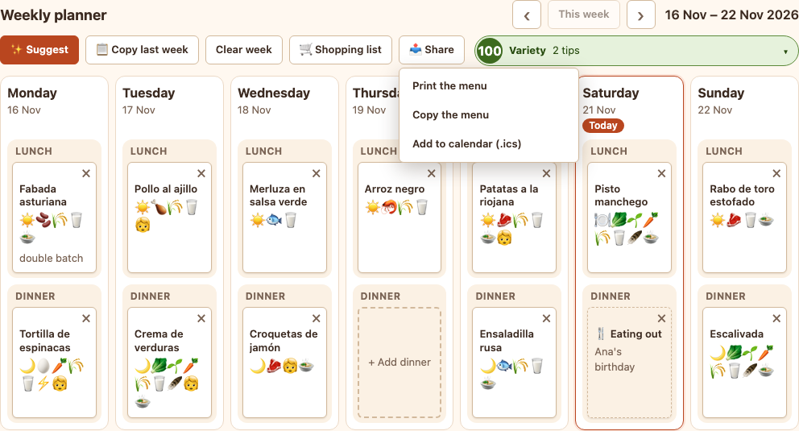

# Print and share

The **Share** button above the week opens a small menu.

{ .screenshot }

**Print the menu**
:   A clean table of the week on one A4 page, black on white, ready for the fridge. In the
    print dialog you can also choose *Save as PDF*.

**Share the menu** / **Copy the menu**
:   Sends the week as text through your phone's share menu (WhatsApp, email…). Where there is
    no share menu, it copies the text instead. If the browser doesn't allow copying, Cociboard
    shows the text so you can select and copy it yourself.

**Add to calendar (.ics)**
:   Downloads a calendar file with one event per planned meal, at the lunch and dinner times
    set in the [household preferences](preferences.md#meal-times) (14:00 and 21:00 unless you
    change them). Open it with your calendar app. Importing a newer file of the same week
    updates the events instead of duplicating them.

The menu items are disabled while the week has no meals.

The shopping list has its own **Print** and **Copy** / **Share** buttons, see
[Shopping list](shopping.md#using-the-list).
