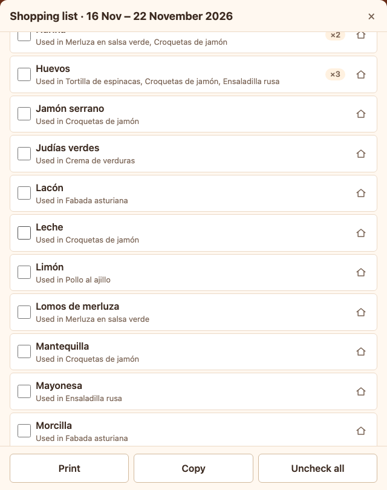
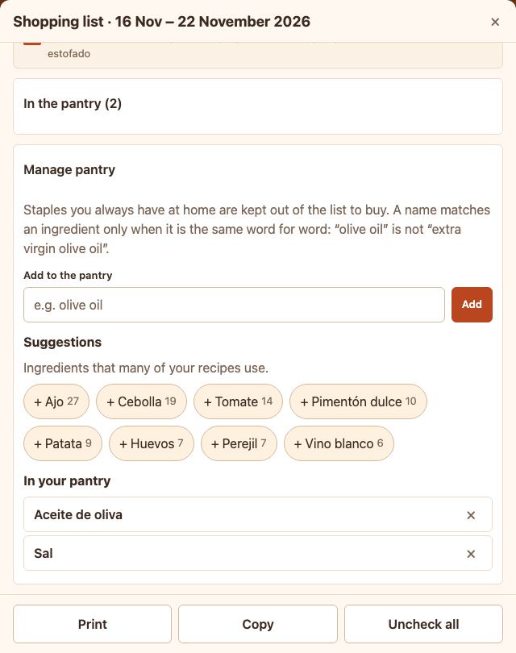

# Shopping list and pantry

Press **Shopping list** above the week (on a phone, the **Shopping** tab). Cociboard gathers
the ingredients of every meal planned in that week into one list.

{ .screenshot .dialog }

## Using the list

- The same ingredient in several recipes appears **once**, with the recipes that use it and
  **×2**, **×3**… when it is needed for several meals. Upper and lower case and accents are
  ignored when merging.
- **Tick** an item as you put it in the basket: it moves from **To buy** to **In the basket**.
  Untick it to bring it back. Ticks are saved, so everyone at home sees the same list on their
  own phone.
- **Add an item** adds anything else you need ("milk", "bread") to this week's list. Remove it
  with **×**.
- **Copy** puts what is still to buy on the clipboard as a simple list to paste in a message
  (on devices that can share, it reads **Share** and opens the share menu).
- **Print** gives a checklist with a box per item.
- **Uncheck all** starts over.

Special meals (*Eating out*, *Leftovers*, *Free*) add nothing. Ingredients have no separate
quantities: they are written inside the ingredient text of each recipe, so look at the recipe
when you need the amount.

## The pantry: things you always have

Oil, salt, garlic… you don't want them on every week's list. Press the :material-home-outline:
**Always at home** button on a line and that ingredient moves to the **In the pantry** section
at the end of the list, for every week.

{ .screenshot .dialog }

- Pantry items are left out of **Copy** and **Share**, with a last line "Also check at home: …"
  so you remember to look.
- Press **Need to buy** on a pantry item to put it back on the list.
- **Manage pantry** lets you add any ingredient by name, remove staples, and offers
  **suggestions**: the ingredients most of your recipes use.

!!! note "Names must match"
    An ingredient is recognised as a pantry item only when its name is the same (upper and
    lower case and accents aside). "Aceite de oliva" in the pantry doesn't cover
    "Aceite de oliva virgen extra"; add each spelling you use.
