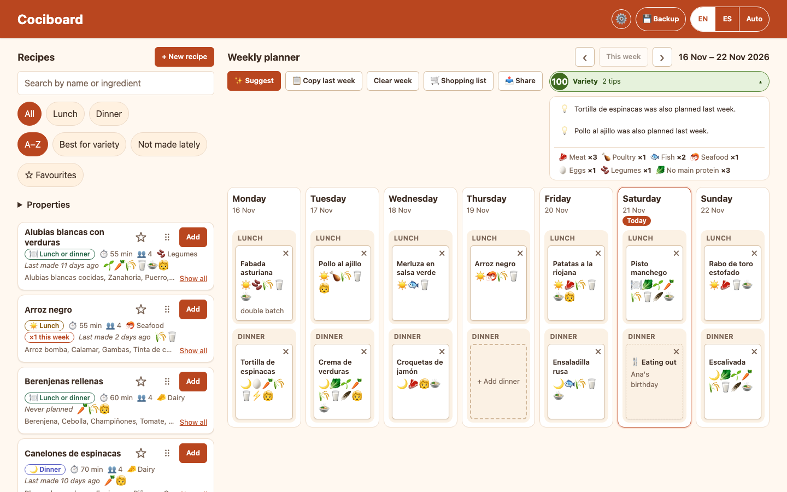

# Variety

Cociboard looks at the week as you plan it and tells you how varied it is. It never stops you
from planning what you want: it only gives advice.

## The variety badge

Next to the week's buttons, a badge shows a **score out of 100** and how many warnings and tips
there are. It is green for a varied week, amber when there is something to look at and red when
the week is very repetitive.

Click the badge to see the details:

{ .screenshot }

- Each line is a **warning** or a **tip**. Click it to highlight the meals involved in the
  grid; a :warning: mark on a slot means it takes part in a warning.
- Below, the number of meals per **main protein** (meat, poultry, fish, seafood, eggs,
  legumes, dairy, tofu, none) shows the balance of the week at a glance.

## What Cociboard checks

| Check | Kind |
| --- | --- |
| The same recipe more than once in the week (fine for *batch cooking* recipes) | Warning, or tip for batch cooking |
| The same main protein in consecutive meals | Warning |
| One main protein in more than 4 meals | Warning |
| Monday's lunch with the same protein as last Sunday's dinner | Warning |
| Fewer than 2 vegetable-forward meals once the week is half planned | Tip |
| Fewer than 2 fish or seafood meals once most of the week is planned | Tip |
| A recipe you also planned in the last two weeks | Tip (doesn't lower the score) |

The numbers 4, 2 and 2 are the defaults. You can change them, or switch a tip off, in the
[household preferences](preferences.md#variety-targets).

## Getting help to fix it

- In the recipe list, sort by **Best for variety**: recipes you haven't planned yet and the
  proteins you have used least come first. Recipes already in the week show **×1 this week**.
- In the picker of a slot, the best fits come first with a **Good pick** mark and a reason.
- **Suggest** always aims for a varied week.
