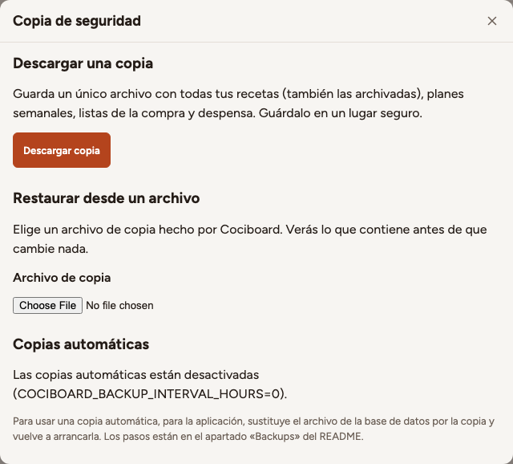

# Copias de seguridad

**Copia de seguridad** en el menú :material-cog: **Ajustes** de la cabecera abre el cuadro de copias de seguridad.

{ .screenshot .dialog }

## Descargar una copia

**Descargar copia** guarda un archivo con todos tus datos: recetas (también las archivadas),
menús semanales, listas de la compra, la despensa y las preferencias del hogar. Guárdalo en un
sitio seguro. También sirve para llevar tus datos a otro Cociboard.

## Restaurar desde un archivo

Elige un archivo de copia. Cociboard te enseña primero lo que contiene (recetas, comidas
planificadas, artículos de la compra y la fecha en que se hizo) y te pide confirmación.

!!! danger "Restaurar lo reemplaza todo"
    Restaurar no combina: todas las recetas, menús, listas de la compra y la despensa actuales
    se sustituyen por el contenido del archivo. Si el archivo no es válido, no cambia nada. El
    servidor guarda una copia de los datos tal y como estaban justo antes de restaurar.

También se pueden restaurar las copias hechas con versiones anteriores de Cociboard.

## Copias automáticas

El servidor también copia la base de datos completa por su cuenta, cada día por defecto y
solo si algo ha cambiado, y guarda las siete últimas. El cuadro muestra cuándo se hizo la
última y avisa si alguna falló. Volver a una de estas copias se hace en el servidor; pídeselo a
quien instaló Cociboard.
