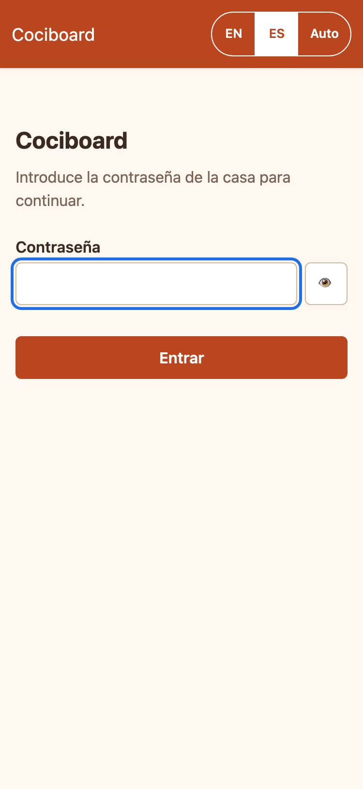
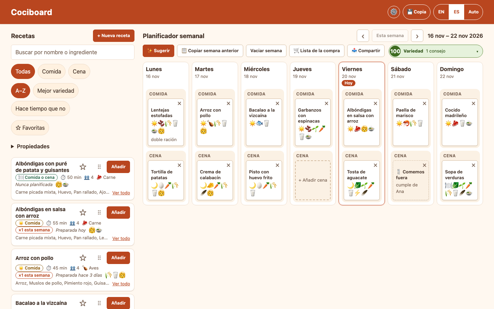
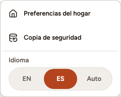

# Primeros pasos

Cociboard funciona en el navegador. Abre la dirección que usa tu casa (por ejemplo
`http://192.168.1.10:8000`, o la que te haya dado quien lo instaló). No hay que instalar nada
en el ordenador; en el móvil puedes [añadirlo a la pantalla de inicio](phone.md#instalalo-como-una-app).

## Entrar

Si tu casa ha puesto una contraseña, Cociboard la pide primero. Todos en casa comparten la
misma. Después de entrar, el navegador te recuerda durante 90 días, que se renuevan cada vez
que lo usas.

{ .screenshot .phone }

Usa **Cerrar sesión** en la cabecera para salir en un ordenador compartido. Si no hay
contraseña, no aparece ninguna pantalla de entrada.

## Un recorrido por la pantalla

En el ordenador todo está en una sola pantalla:

{ .screenshot }

**Cabecera** (arriba)
:   El botón :material-cog: abre las [preferencias del hogar](preferences.md), **Copia** abre
    las [copias de seguridad](backups.md) y **EN | ES | Auto** elige el idioma.

**Recetas** (izquierda)
:   Tu catálogo de recetas, con buscador, filtros y orden. Arrastra una tarjeta a la semana o
    usa **Añadir**. Consulta [Recetas](recipes.md).

**Planificador semanal** (derecha)
:   Siete días, cada uno con un hueco de comida y otro de cena. Encima están la navegación
    entre semanas, las acciones para toda la semana y el indicador de variedad.

{ .screenshot }

En el móvil las mismas secciones se muestran de una en una, y se eligen en una barra en la
parte de abajo. Consulta [En el móvil](phone.md).

## Idioma

{ .screenshot }

La primera vez, Cociboard usa el idioma del navegador (español si el navegador está en
cualquier variante de español; inglés en otro caso). Elige **EN** o **ES** en la cabecera para
cambiarlo en este dispositivo, o **Auto** para volver a seguir al navegador.

Solo se traduce la interfaz. Tus recetas se quedan tal y como las escribiste.

## Las recetas de partida

Un Cociboard nuevo trae 33 recetas clásicas de la cocina española, cada una con sus ingredientes,
raciones y pasos, para que puedas planificar desde el primer momento. Edítalas, archiva las
que no cocinas y añade las tuyas.
