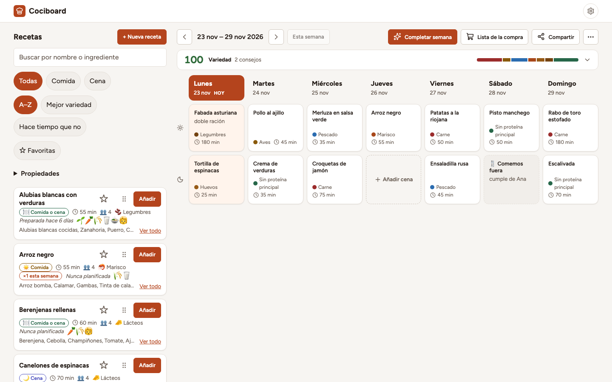

# Menús semanales variados, sin esfuerzo

Cociboard es un planificador de menús semanales para tu casa. Guardas tus propias recetas, las
colocas en una cuadrícula de lunes a domingo con una **comida** y una **cena** por día, y
Cociboard te ayuda a que la semana sea variada, prepara la lista de la compra y te deja
compartir el menú.

{ .screenshot }

## Qué puedes hacer

-   :material-calendar-week: **[Planificar la semana](planning.md)**

    Arrastra recetas a los días, o toca un hueco y elige. Marca comidas como *Comemos fuera*
    o *Sobras* y añade notas cortas.

-   :material-auto-fix: **[Dejar que Cociboard sugiera](planning.md#deja-que-cociboard-rellene-la-semana)**

    Rellena los huecos vacíos de un clic con recetas variadas que no has preparado hace poco.

-   :material-chart-donut: **[Comer variado](variety.md)**

    Una puntuación y consejos discretos avisan de recetas repetidas o de la misma proteína
    varias comidas seguidas.

-   :material-book-open-variant: **[Guardar tus recetas](recipes.md)**

    Ingredientes, pasos, raciones y el enlace original. Importa recetas desde una página web.

-   :material-cart: **[Comprar con lista](shopping.md)**

    Los ingredientes de la semana en una sola lista, compartida por toda la casa, sin los
    básicos que siempre tienes.

-   :material-cellphone: **[Usarlo en el móvil](phone.md)**

    Instálalo como una app, mira las comidas de hoy de un vistazo y sigue trabajando sin
    conexión.

## Por dónde empezar

1. Lee [Primeros pasos](getting-started.md) para conocer la pantalla.
2. Sigue [Planificar la semana](planning.md) para llenar tu primera semana.
3. Abre la [lista de la compra](shopping.md) y a cocinar.

!!! tip "¿Con prisa?"
    Pulsa **Completar semana** en una semana vacía, revisa el resultado, cambia lo que no te apetezca y
    abre la **Lista de la compra**. Semana planificada en dos minutos.

La interfaz está en español y en inglés, y esta guía también: usa el menú de idioma
:material-translate: de la parte superior de la página.
