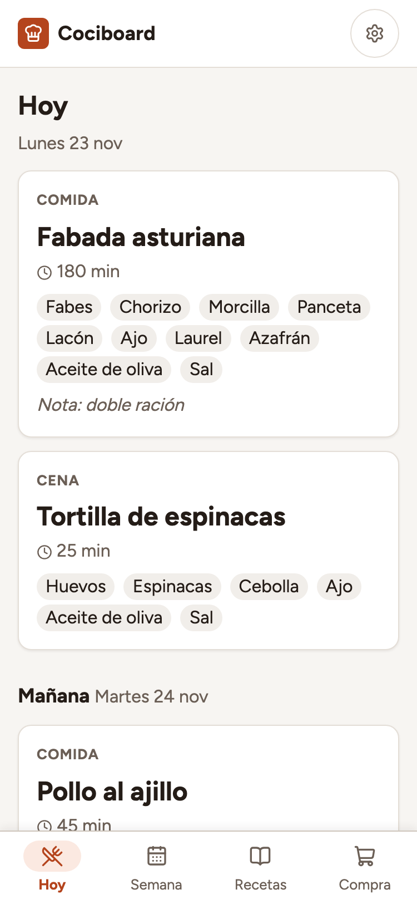
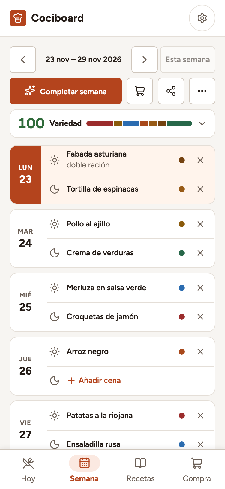
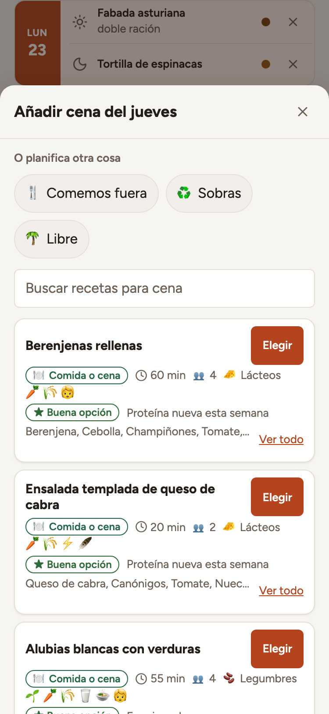
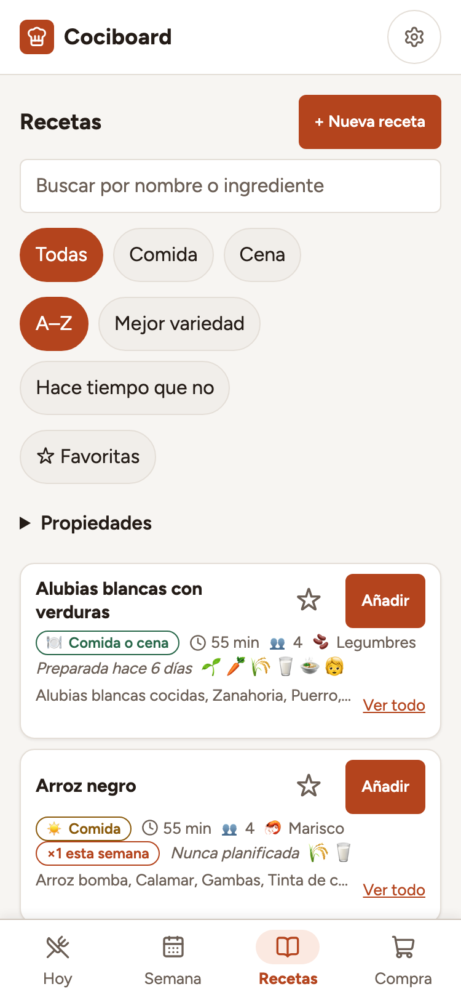
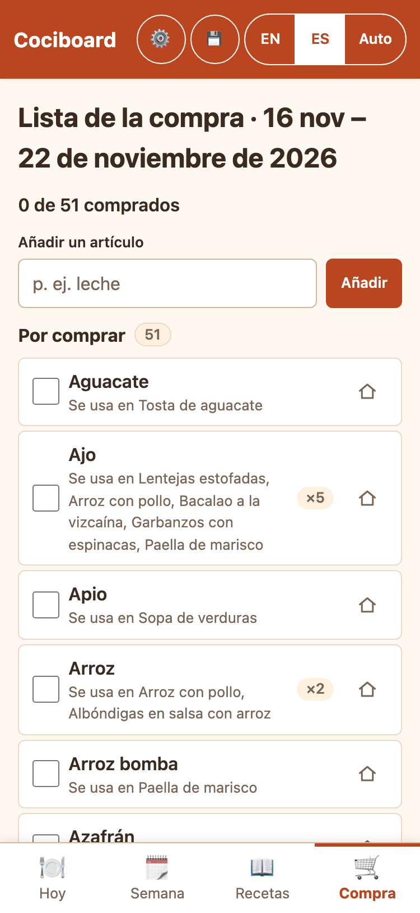

# En el móvil

Cociboard está pensado tanto para el móvil como para el ordenador. En una pantalla estrecha
muestra una sección cada vez, que eliges en la barra de abajo:

{ .screenshot .phone }

{ .screenshot .phone }

{ .screenshot .phone }

**Hoy**
:   La comida y la cena de hoy y de mañana, con los ingredientes y las notas. Toca una receta
    para ver los pasos mientras cocinas.

**Semana**
:   El planificador, como una lista compacta: una fila por día, con el día de la semana a la
    izquierda y las líneas de comida (:material-weather-sunny:) y cena
    (:material-weather-night:) a la derecha, cada una con un punto de su proteína principal. Caben
    unos cuatro días en la pantalla. Se abre en la fila de hoy. Toca una línea para elegir una
    receta o, si ya tiene una comida, para ver sus acciones. También puedes arrastrar: mantén
    pulsada una comida un momento y muévela. Los botones de encima de la lista son
    **Completar semana**, **Lista de la compra** y **Compartir** (solo iconos) y **Más**, con
    *Copiar semana anterior* y *Vaciar semana*.

**Recetas**
:   El catálogo. **Añadir** en una receta te lleva a la semana para elegir el hueco.

**Compra**
:   La lista de la compra de la semana que estás viendo, lista para ir marcando en la tienda.

{ .screenshot .phone }

{ .screenshot .phone }

## Instálalo como una app

Añade Cociboard a la pantalla de inicio y se abrirá a pantalla completa con su propio icono:

=== "iPhone y iPad (Safari)"

    Toca **Compartir** :material-export-variant: y después **Añadir a pantalla de inicio**.

=== "Android (Chrome)"

    Abre el menú :material-dots-vertical: y después **Instalar aplicación** (o **Añadir a
    pantalla de inicio**).

Cuando se instala una versión nueva de Cociboard, aparece una barra con **Recargar**; nada
cambia hasta que la tocas.

## Sin conexión

Si el móvil pierde la conexión, Cociboard sigue funcionando con lo último que cargó: los menús,
las recetas y las listas de la compra que ya abriste. Un aviso indica que estás sin conexión.

Puedes seguir **planificando, marcando artículos de la compra y cambiando la despensa, las
preferencias y tus favoritas**. Los cambios se ven al momento y el aviso cuenta los pendientes.
Se guardan en el móvil aunque cierres la app, y se envían en orden en cuanto vuelve la
conexión.

!!! warning "Conviene saber"
    - Los cambios pendientes durante más de 7 días se descartan (Cociboard te dice cuántos).
    - Crear y editar recetas, las copias de seguridad, entrar y cerrar sesión necesitan
      conexión.
    - Para trabajar sin conexión hace falta la dirección segura (`https://`) de Cociboard. Con
      una dirección `http://` la app funciona con normalidad, pero no sin conexión. Pregunta a
      quien lo instaló.
