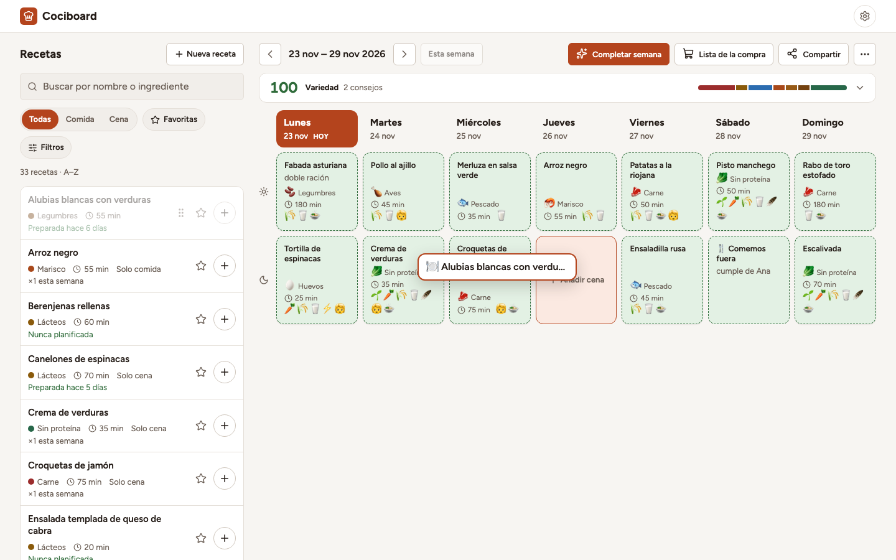
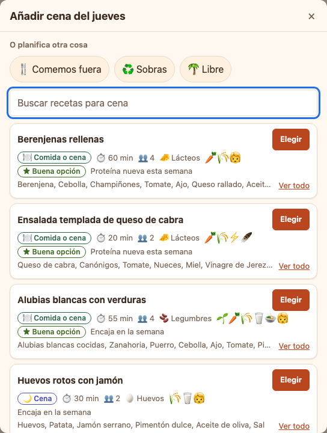
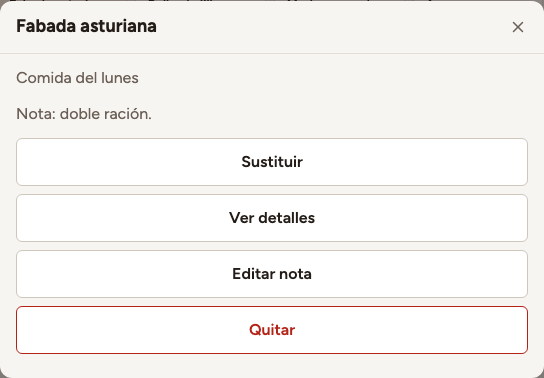
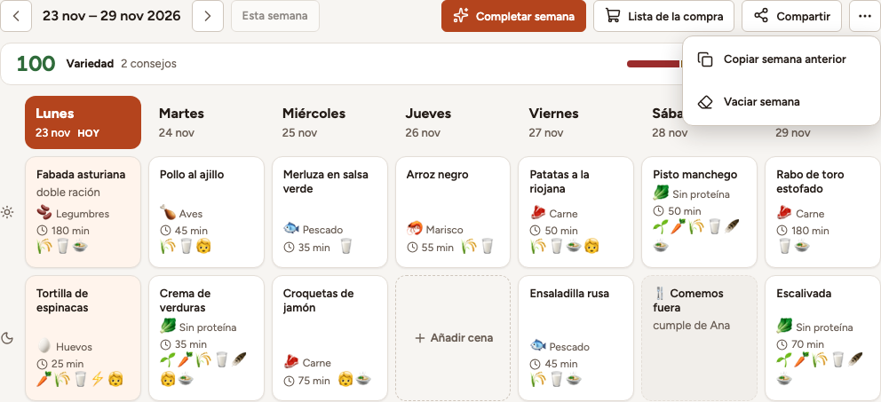

# Planificar la semana

Cada día tiene dos huecos, **comida** y **cena**. Un hueco contiene una receta, una comida
especial (*Comemos fuera*, *Sobras*, *Libre*) o nada.

En el ordenador la semana es una cuadrícula: una columna por día, una fila para la comida
(:material-weather-sunny:) y otra para la cena (:material-weather-night:). Una receta planificada
es una tarjeta con su nombre, el icono y el nombre de su proteína principal, su tiempo de
preparación y los iconos de sus propiedades (vegetariana, rápida, picante…). Un hueco vacío es un recuadro de rayas con **Añadir comida** o **Añadir cena**. Una
marca :material-alert: en una tarjeta indica que forma parte de un [aviso de
variedad](variety.md). La columna de hoy aparece resaltada.

## Moverse entre semanas

Usa **‹** y **›** para ir a la semana anterior o a la siguiente, y **Esta semana** para volver.
La semana forma parte de la dirección de la página, así que puedes guardar una semana en
favoritos y el botón Atrás del navegador funciona.

## Añadir una comida

Hay tres formas; usa la que te resulte más cómoda.

### Arrastrar y soltar (ordenador)

Arrastra una receta de la lista a un hueco. Mientras arrastras, los huecos que
admiten la receta se resaltan y los demás se atenúan: una receta solo para cenas nunca cabe en
un hueco de comida, y al revés.

{ .screenshot }

También puedes arrastrar comidas ya planificadas: suéltala en otro hueco para **moverla**, en
un hueco ocupado para **intercambiar** las dos, o sobre la lista de recetas para **quitarla**
de la semana.

### Tocar un hueco y elegir

Toca (o haz clic en) un hueco vacío. Se abre una lista solo con las recetas que caben en ese
hueco, primero las mejores para la variedad; las mejores tienen fondo verde y la etiqueta **Buena opción**, y cada fila muestra un motivo
breve («Añade pescado o marisco», «Proteína nueva esta semana»; un aviso con su icono si
perjudicaría la variedad) para ayudarte a decidir. Escribe para buscar y pulsa **Elegir**.

{ .screenshot .dialog }

### Añadir y luego elegir el hueco

Pulsa el botón redondo **+** de una receta y luego toca uno de los huecos resaltados. Pulsa
**Esc** o **Cancelar** para dejarlo.

!!! info "Con el teclado"
    Con Tab, ve al asa :material-drag: de una receta o a una comida planificada y pulsa
    **Espacio** para cogerla. Usa las flechas para saltar entre huecos, **Espacio** para
    soltarla y **Esc** para cancelar. **Intro** sobre una comida planificada abre sus acciones;
    **Intro** sobre un hueco vacío abre el selector. Cada paso se anuncia a los lectores de
    pantalla.

## ¿No se cocina? Comidas especiales

En la parte de arriba del selector, bajo **O planifica otra cosa**, encontrarás:

| Opción | Para qué sirve |
| --- | --- |
| :fork_and_knife: **Comemos fuera** | Una comida en un restaurante o en casa de alguien |
| :recycle: **Sobras** | Comer lo que quedó de una comida anterior |
| :palm_tree: **Libre** | Un hueco que dejas abierto a propósito |

Una comida especial ocupa el hueco, así que **Completar semana** no lo toca. Además corta una racha de
la misma proteína y no añade nada a la lista de la compra.

## Cambiar una comida planificada

Toca una comida planificada para ver qué puedes hacer con ella:

{ .screenshot .dialog }

- **Sustituir** abre el selector para elegir otra cosa.
- **Ver detalles** muestra la receta completa.
- **Añadir nota** / **Editar nota**: una nota corta de hasta 120 caracteres («doble ración»,
  «cumple de Ana»). La nota se queda en el hueco aunque cambies la comida.
- **Quitar** vacía el hueco. La pequeña **×** de la comida hace lo mismo (con el ratón aparece
  al señalar la comida; en una pantalla táctil está siempre).
- **Guardar las sobras para la siguiente comida** aparece en las recetas de *cocina por lotes*
  cuando el hueco siguiente está vacío: planifica *Sobras* allí, con el nombre de la receta
  como nota.

Para cambiar la receta en sí (sus ingredientes, por ejemplo), ábrela y pulsa **Editar**; todas
las semanas que la usan muestran el cambio.

## Deja que Cociboard rellene la semana

Los botones de encima de la cuadrícula actúan sobre toda la semana. **Completar semana** es el
principal; los otros dos están en el menú :material-dots-horizontal: **Más** (*Más acciones de
la semana*).

{ .screenshot }

**Completar semana**
:   Rellena solo los huecos **vacíos** con recetas variadas que encajen, prefiriendo las que no
    has preparado últimamente y respetando las [preferencias del hogar](preferences.md). Nunca
    sustituye lo que tú has elegido. Vuelve a pulsarlo tras vaciar algunos huecos para tener
    otras ideas. Aparece apagado cuando todos los huecos ya están llenos.

**Copiar semana anterior** (en **Más**)
:   Rellena los huecos vacíos con las comidas de la semana pasada (con las comidas especiales y
    las notas). Las recetas archivadas se omiten.

**Vaciar semana** (en **Más**)
:   Vacía toda la semana, después de pedirte confirmación.

Después de cualquiera de las tres aparece durante unos segundos un mensaje con **Deshacer**.
Púlsalo para dejar la semana exactamente como estaba.

!!! tip "Consejo"
    Una buena rutina: planifica primero las comidas que de verdad te apetecen y después pulsa
    **Completar semana** para rellenar el resto.
