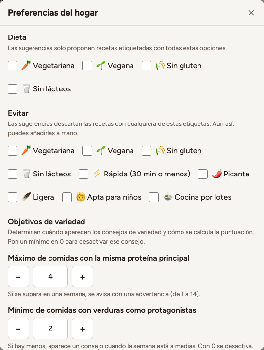

# Preferencias del hogar

**Preferencias del hogar**, en el menú :material-cog: **Ajustes** de la cabecera, abre las preferencias de tu casa. Las comparten todas las
personas que usan el mismo Cociboard.

{ .screenshot .dialog }

## Dieta

Marca **vegetariana**, **vegana**, **sin gluten** o **sin lácteos** y las sugerencias (el botón
**Sugerir** y el orden de las mejores opciones en el selector de un hueco) solo propondrán
recetas etiquetadas con todas ellas.

## Evitar

Marca cualquier propiedad (por ejemplo **picante**) y las sugerencias se saltarán las recetas
que la tengan.

Las recetas se comparan por sus etiquetas tal cual: una receta etiquetada solo como *vegana* no
cuenta como *vegetariana*, así que etiqueta bien tus recetas.

!!! info "Las preferencias nunca te bloquean"
    Puedes poner cualquier receta en cualquier hueco tú mismo. En el selector de un hueco, las
    recetas fuera de tus preferencias van al final, marcadas como «Fuera de las preferencias del
    hogar». Si tus preferencias dejan huecos sin rellenar, **Sugerir** te lo dice.

## Objetivos de variedad

Estos números deciden cuándo aparecen los consejos de [variedad](variety.md) y cómo se calcula la
puntuación:

- **Máximo de comidas con la misma proteína principal** (de 1 a 14; 4 por defecto).
- **Mínimo de comidas con verduras como protagonistas** (2 por defecto).
- **Mínimo de comidas con pescado o marisco** (2 por defecto).

Pon un mínimo a **0** para desactivar ese consejo.

## Horarios de las comidas

Cuándo empiezan la comida y la cena en el [archivo de calendario](sharing.md) que exportas
(14:00 y 21:00 por defecto).

Pulsa **Guardar**. El cambio se aplica al momento, incluso sin conexión (se envía en cuanto
vuelve).
