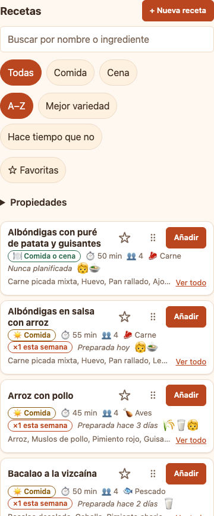

# Recetas

La lista de recetas es tu catálogo: todo lo que puedes poner en la semana.

{ .screenshot .dialog }

## Encontrar una receta

- **Busca** por nombre o ingrediente. Mayúsculas, minúsculas y tildes dan igual: «pimenton»
  encuentra «Pimentón».
- **Todas / Comida / Cena** muestra las recetas que caben en esa comida.
- **Propiedades** filtra por vegetariana, vegana, sin gluten, rápida, etc. (la receta debe
  tener todas las que marques).
- :star: **Favoritas** muestra solo tus favoritas, combinado con los demás filtros.
- Ordena **A–Z**, por **Mejor variedad** o por **Hace tiempo que no** (primero las que nunca
  has planificado y después las que planificaste hace más tiempo).

Cada tarjeta muestra el tipo de comida, el tiempo, las raciones, la proteína principal y las
propiedades como iconos (abre **Leyenda**, debajo de la lista, para ver qué significa cada
uno), cuándo la preparaste por última vez («Preparada hace 3 días», «Nunca planificada») y
cuántas veces está en la semana actual.

## Detalles de una receta

Haz clic en el nombre de una receta (o en **Ver detalles** en una comida planificada) para
verlo todo:

{ .screenshot .dialog }

- Los ingredientes y los **pasos** numerados, y el enlace a la receta original si lo tiene.
- **Historial**: cuántas veces la has planificado, la próxima vez que está planificada y las
  últimas comidas.
- :star: **Favorita** la marca como favorita. Las favoritas son un atajo para ti; no cambian lo
  que propone **Completar semana**.
- **Editar**, **Archivar** y **Eliminar**, abajo.

## Añadir una receta

Pulsa **Nueva receta**. En el móvil el formulario ocupa toda la pantalla.

{ .screenshot .dialog }

| Campo | |
| --- | --- |
| **Nombre** | Obligatorio, único, hasta 80 caracteres |
| **Tipo de comida** | **Comida**, **Cena** o **Ambas**. Decide en qué huecos cabe la receta |
| **Proteína principal** | La usan las comprobaciones de [variedad](variety.md) |
| **Tiempo de preparación**, **Raciones**, **Descripción** | Opcionales |
| **Ingredientes** | Al menos uno. **Intro** añade una fila; al pegar una lista se separa en filas. Escribe las cantidades como quieras («200 g de lentejas») |
| **Pasos** | Opcionales y numerados. Cámbialos de orden con los botones de flecha |
| **Enlace de origen** | Opcional: la página de donde viene la receta |
| **Propiedades** | Vegetariana, vegana, sin gluten, sin lácteos, rápida, picante, ligera, apta para niños, cocina por lotes |

Pulsa **Crear receta** para guardarla.

### Importar una receta desde una página web

En la parte de arriba del formulario, pega la dirección de una página de recetas en
**Importar desde un enlace** y pulsa **Importar**. Cociboard rellena el nombre, la
descripción, las raciones, el tiempo, los ingredientes, los pasos y el enlace de origen.
**No se guarda nada hasta que pulses Crear receta**, así que revisa el resultado y elige tú el
**tipo de comida** y la **proteína principal**: las páginas web no lo indican.

La mayoría de las webs de recetas funcionan, porque publican sus recetas en un formato estándar
para los buscadores. Algunas no (páginas que piden iniciar sesión, PDF, webs que bloquean el
acceso automático); Cociboard te avisa cuando no puede leer una página.

!!! tip "En Android"
    Cuando Cociboard está [instalado en el móvil](phone.md#instalalo-como-una-app), aparece en
    el menú **Compartir**. Comparte una página de recetas desde el navegador y Cociboard abre
    el formulario y la importa.

## Editar una receta

Abre la receta y pulsa **Editar**. Los cambios se ven en todas las semanas donde está
planificada. Si cambias el tipo de comida y la receta está en huecos donde ya no cabe (una
receta de comida que pasa a ser solo de cena, por ejemplo), el formulario te los enseña y
ofrece **Quitarlas y guardar**.

## ¿Archivar o eliminar?

**Archivar** (recomendado)
:   Oculta la receta de la lista y de las sugerencias, pero la mantiene en las semanas donde
    estaba planificada, marcada como «Archivada». La encontrarás en **Archivadas (N)**, al final
    de la lista, y puedes recuperarla con **Restaurar**.

**Eliminar**
:   Borra la receta para siempre, junto con todas las comidas que la usan, también en semanas
    pasadas. La confirmación te dice cuántas comidas desaparecerán y te sugiere
    **Archivar en su lugar**.
