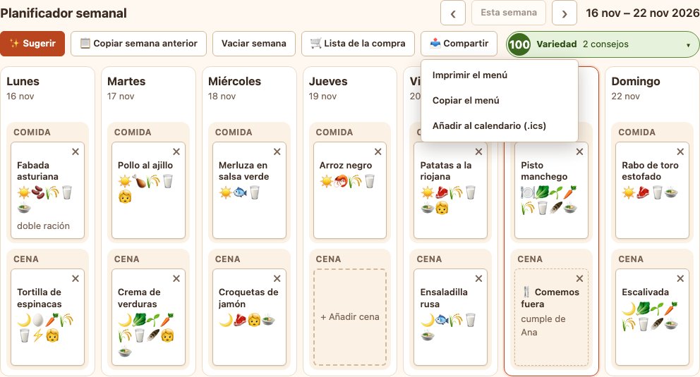

# Imprimir y compartir

El botón **Compartir** de encima de la semana abre un pequeño menú.

{ .screenshot }

**Imprimir el menú**
:   Una tabla limpia de la semana en una hoja A4, en blanco y negro, lista para la nevera. En el
    cuadro de impresión también puedes elegir *Guardar como PDF*.

**Compartir el menú** / **Copiar el menú**
:   Envía la semana como texto con el menú de compartir del móvil (WhatsApp, correo…). Donde no
    hay menú de compartir, copia el texto. Si el navegador no permite copiar, Cociboard muestra
    el texto para que lo selecciones y lo copies tú.

**Añadir al calendario (.ics)**
:   Descarga un archivo de calendario con un evento por comida planificada, a las horas de
    comida y cena de las [preferencias del hogar](preferences.md#horarios-de-las-comidas)
    (14:00 y 21:00 si no las cambias). Ábrelo con tu aplicación de calendario. Si importas un
    archivo más reciente de la misma semana, los eventos se actualizan en lugar de duplicarse.

Las opciones están desactivadas mientras la semana no tiene comidas.

La lista de la compra tiene sus propios botones **Imprimir** y **Copiar** / **Compartir**;
consulta [Lista de la compra](shopping.md#usar-la-lista).
