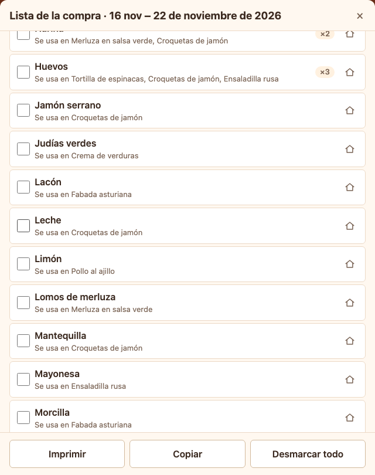
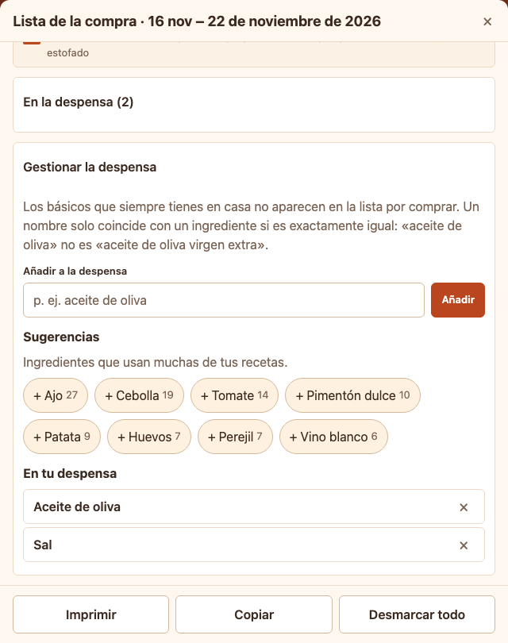

# Lista de la compra y despensa

Pulsa **Lista de la compra** encima de la semana (en el móvil, la pestaña **Compra**). Cociboard
reúne en una sola lista los ingredientes de todas las comidas planificadas esa semana.

{ .screenshot .dialog }

## Usar la lista

- Un mismo ingrediente de varias recetas aparece **una sola vez**, con las recetas que lo usan
  y **×2**, **×3**… cuando hace falta para varias comidas. Al juntarlos se ignoran las
  mayúsculas y las tildes.
- **Marca** un artículo al meterlo en la cesta: pasa de **Por comprar** a **En la cesta**.
  Desmárcalo para devolverlo. Las marcas se guardan, así que todos en casa ven la misma lista en
  su propio móvil.
- **Añadir un artículo** añade cualquier otra cosa que necesites («leche», «pan») a la lista de
  esta semana. Quítalo con **×**.
- **Copiar** pone en el portapapeles lo que queda por comprar, como una lista sencilla para
  pegar en un mensaje (en los dispositivos que pueden compartir pone **Compartir** y abre el menú
  de compartir).
- **Imprimir** da una lista con una casilla por artículo.
- **Desmarcar todo** empieza de nuevo.

Las comidas especiales (*Comemos fuera*, *Sobras*, *Libre*) no añaden nada. Los ingredientes no
tienen cantidades aparte: están escritas dentro del texto de cada ingrediente, así que mira la
receta cuando necesites la cantidad.

## La despensa: lo que siempre tienes

Aceite, sal, ajo… no los quieres en la lista todas las semanas. Pulsa el botón
:material-home-outline: **Siempre en casa** de una línea y ese ingrediente pasa a la sección
**En la despensa**, al final de la lista, en todas las semanas.

{ .screenshot .dialog }

- Los artículos de la despensa no se incluyen al **Copiar** ni al **Compartir**; una última
  línea, «Comprueba también en casa: …», te recuerda que los mires.
- Pulsa **Hay que comprar** en un artículo de la despensa para devolverlo a la lista.
- **Gestionar la despensa** te deja añadir cualquier ingrediente por su nombre, quitar básicos
  y te ofrece **sugerencias**: los ingredientes que más usan tus recetas.

!!! note "Los nombres deben coincidir"
    Un ingrediente se reconoce como de la despensa solo si su nombre es el mismo (sin contar
    mayúsculas y tildes). «Aceite de oliva» en la despensa no cubre «Aceite de oliva virgen
    extra»; añade cada forma de escribirlo que uses.
