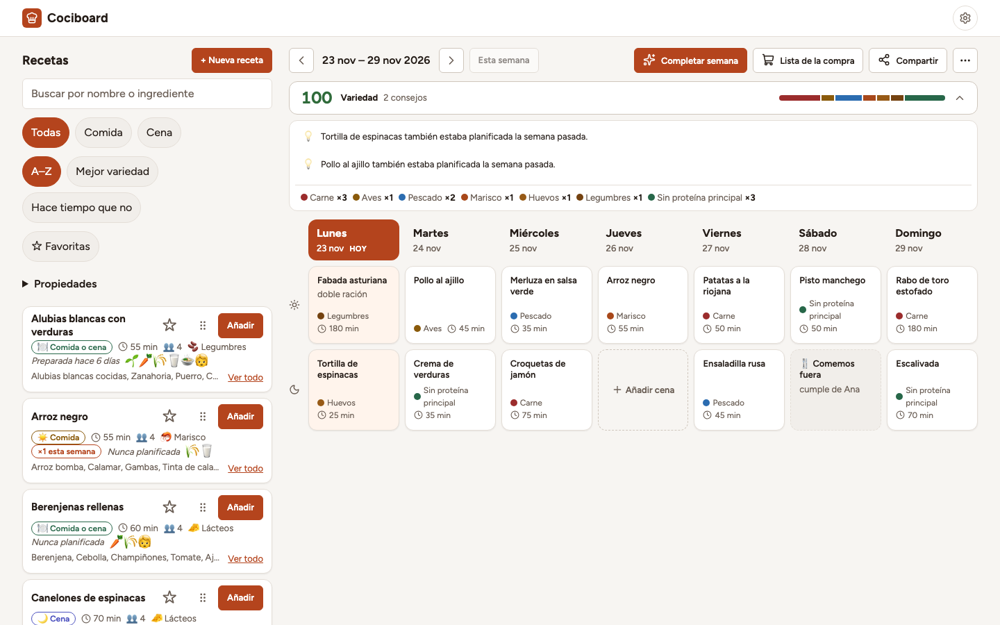

# Variedad

Cociboard mira la semana mientras la planificas y te dice cómo de variada es. Nunca te impide
planificar lo que quieras: solo te aconseja.

## La barra de variedad

Debajo de los botones de la semana, una barra muestra una **puntuación sobre 100**, cuántos
avisos y consejos hay y una franja fina de colores con las proteínas principales de la semana,
un color para cada una. La puntuación es verde si la semana es variada, ámbar si hay algo
que mirar y roja si es muy repetitiva.

Haz clic en la barra para ver los detalles:

{ .screenshot }

- Cada línea es un **aviso** o un **consejo**. Haz clic en ella para resaltar en la cuadrícula
  las comidas implicadas; una marca :warning: en un hueco indica que forma parte de un aviso.
- Debajo, el número de comidas por **proteína principal** (carne, aves, pescado, marisco,
  huevos, legumbres, lácteos, tofu, sin proteína principal) muestra el equilibrio de la semana
  de un vistazo.

## Qué comprueba Cociboard

| Comprobación | Tipo |
| --- | --- |
| La misma receta más de una vez en la semana (normal en recetas de *cocina por lotes*) | Aviso, o consejo si es cocina por lotes |
| La misma proteína principal en comidas seguidas | Aviso |
| Una misma proteína principal en más de 4 comidas | Aviso |
| La comida del lunes con la misma proteína que la cena del domingo anterior | Aviso |
| Menos de 2 comidas con verduras como protagonistas cuando la semana está a medias | Consejo |
| Menos de 2 comidas de pescado o marisco cuando la semana está casi completa | Consejo |
| Una receta que también planificaste en las dos últimas semanas | Consejo (no baja la puntuación) |

Los números 4, 2 y 2 son los valores por defecto. Puedes cambiarlos, o desactivar un consejo,
en las [preferencias del hogar](preferences.md#objetivos-de-variedad).

## Ayuda para mejorarla

- En la lista de recetas, ordena por **Mejor variedad**: primero las recetas que aún no has
  planificado y las proteínas que menos has usado. Las que ya están en la semana muestran
  **×1 esta semana**.
- En el selector de un hueco, las que mejor encajan van primero, con la marca **Buena opción**
  y un motivo.
- **Completar semana** siempre busca una semana variada.
